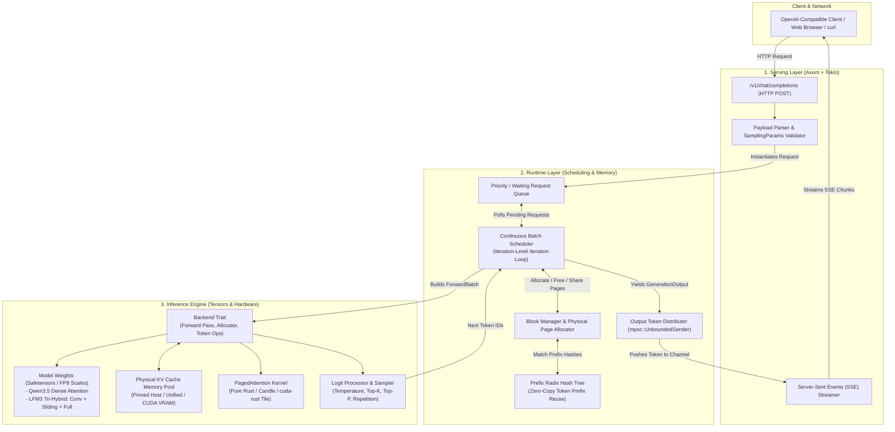
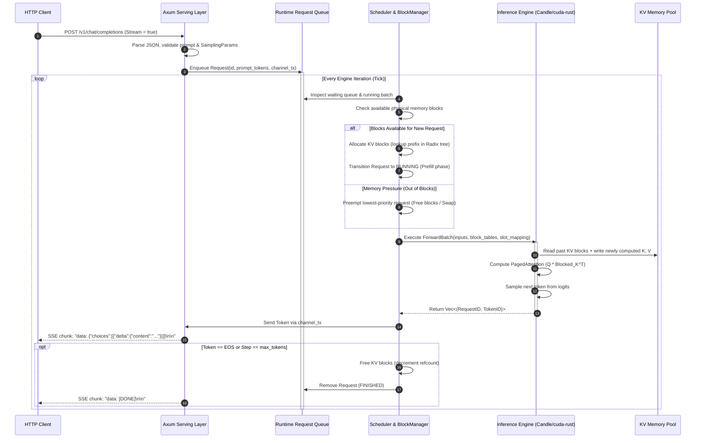

# Module 00: Project Scaffold & System Architecture Philosophy

## 1. Learning Objectives
- **Understand the Core Challenges of LLM Serving**: Contrast standard batch deep learning inference with auto-regressive decoding workloads (memory fragmentation, variable length requests, memory-bound decode vs compute-bound prefill).
- **Dissect Production LLM Runtimes**: Compare the architectural paradigms of **vLLM** (PagedAttention, centralized block manager), **SGLang** (RadixAttention, jump-forward KV reuse, fast interpreter), and **TensorRT-LLM** (static graphs, C++ execution engine, In-Flight Batching).
- **Map Out the 3-Tier Layered Architecture**:
  1. *Serving Layer*: HTTP REST/SSE interface, connection multiplexing, token streaming.
  2. *Runtime Layer*: Request queueing, continuous batch scheduling, KV block table tracking, physical memory management.
  3. *Inference Engine Layer*: Tensor computations, model weight representations (FP8/BF16), and low-level attention kernels (PagedAttention, sliding-window, gated convolutions).
- **Design a Idiomatic, High-Performance Rust Foundation**:
  - Establish crate hierarchy and conditional compilation (`cfg(feature = "cuda")`).
  - Configure dependencies (Candle for tensor algebra, Axum for serving, Tokio for asynchronous task orchestration, and NVIDIA's `cuda-rust` / `cutile-rs` / `cuda-oxide` for device kernels).
  - Build robust, structured error hierarchies (`thiserror`) and contextual runtime diagnostics (`tracing`).

---

## 2. Conceptual Deep Dive: Why Build an LLM Engine in Rust?

### The Auto-Regressive Bottleneck
Serving Large Language Models (LLMs) differs fundamentally from serving traditional CNN or ResNet vision models:
1. **Two Distinct Phases with Drastically Different Compute Characteristics**:
   - **Prefill (Prompt Processing)**: The entire prompt sequence $S$ is processed in one shot. The query, key, and value projections are Matrix-Matrix multiplications ($GEMM$). This phase is **compute-bound** ($\text{FLOPs} \gg \text{Bytes loaded}$) and achieves near-peak GPU arithmetic throughput.
   - **Decode (Token Generation)**: Tokens are generated sequentially, one token per step. Each step projects 1 query vector against all historical key-value vectors. This is a Matrix-Vector multiplication ($GEMV$). This phase is severely **memory-bandwidth bound** ($\text{FLOPs} \ll \text{Bytes loaded}$). The arithmetic intensity is tiny: you load gigabytes of KV cache from High-Bandwidth Memory (HBM) to compute a few hundred FLOPs per token.
2. **Dynamic Sequences & Dynamic Lifetimes**:
   - Requests arrive at random timestamps with unpredictable prompt lengths and unknown output token lengths.
   - Traditional static batching (padding requests to the maximum sequence length) wastes up to 60-80% of GPU memory and compute on `<pad>` tokens.
3. **The KV Cache Memory Crisis**:
   - In standard Transformers, every token attention computation requires the past keys and values:
     $$\text{KV Cache Size per Token} = 2 \times L \times H_{KV} \times D \times \text{sizeof(dtype)}$$
     *(where $L$ is number of layers, $H_{KV}$ is number of key-value heads, and $D$ is head dimension).*
   - For an LFM3 / Qwen model with 24 layers, 4 KV heads, 128 head dimension in 16-bit float:
     $$2 \times 24 \times 4 \times 128 \times 2 = 49,152 \text{ bytes per token} \approx 48 \text{ KB / token}$$
   - At 100 concurrent requests with an average context of 8,192 tokens:
     $$100 \times 8,192 \times 48\text{ KB} \approx 39.3 \text{ GB}$$
     just for the temporary KV states!

### Architectural Comparison: vLLM vs. SGLang vs. TensorRT-LLM vs. rust-infer

| Architectural Feature | vLLM (Python/C++/CUDA) | SGLang (Python/C++/CUDA) | TensorRT-LLM (C++/CUDA) | **rust-infer (Rust / Candle / cuda-rust)** |
| :--- | :--- | :--- | :--- | :--- |
| **Language & Safety** | Python control plane, C++ scheduler, CUDA kernels. GIL contention during high request rates. | Python frontend + Rust/C++ Radix Router. Python runtime overhead for complex state machines. | Pure C++ runtime. High performance, but manual memory management and memory unsafety risks. | **100% Rust control & runtime plane**. Zero-cost abstractions, data-race freedom by construction, compile-time thread safety. |
| **Memory Paging** | PagedAttention (logical-to-physical block tables). | RadixAttention (LRU tree of KV blocks matching token prefixes). | In-flight batching with paged KV allocator. | **Unified PagedAllocator + Prefix Radix Table** built natively with Rust's `Arc` and atomic reference counts. |
| **Hybrid Architectures** | Primarily causal Transformers (dense & MoE). Custom attention for RNNs requires complex integration. | Focuses on Transformer LLMs & multi-modal. | Deeply optimized for standard Transformers (Llama, Falcon, GPT). | **Extensible for Tri-Hybrid models** (such as Liquid AI's **LFM3-1.7B**: Conv + Sliding Window + Full Attention). |
| **Kernel Interop** | PyTorch C++ Extensions, Triton, custom CUDA C++. | Custom Triton kernels & FlashInfer C++ bindings. | CUTLASS, TensorRT plugins, handwritten CuTe C++ templates. | **Candle backend** with pure Rust CPU fallback, plus direct hooks for **NVIDIA `cuda-rust` (`cutile-rs`, `cuda-oxide`)** and PTX. |
| **Concurrency Model**| Python `asyncio` or Ray actors (subject to GIL / IPC serialization). | Python FastAPI / Uvicorn + IPC backend. | Thread-pools & C++ std::thread / MPI. | **Tokio multi-threaded async runtime + Rayon data parallelism**. MPSC channels for non-blocking iteration scheduling. |

---

## 3. High-Level Architecture Overview

The `rust-infer` architecture strictly decouples responsibilities across three discrete layers:



### Low-Level Control Flow of a Single Generation Step



---

## 4. Hardware & Memory Reality: GPU vs. Host Architecture

To write high-performance systems code, you must picture the hardware topology and data movement pathways:

```mermaid
graph LR
    subgraph Host["Host System (CPU & DDR5)"]
        CPU[Host CPU Cores]
        DDR[Host RAM / Pinned Host Memory]
        TokioWorker[Tokio Async Thread Pool]
        RayonWorker[Rayon Compute Thread Pool]
    end

    subgraph PCIe["PCIe Gen4 / Gen5 Bus (32 - 64 GB/s)"]
        DMA[Direct Memory Access Transfer]
    end

    subgraph Device["NVIDIA GPU (e.g. H100 / B200 / RTX 4090)"]
        HBM[HBM3 / GDDR6X VRAM (1 - 3 TB/s)]
        SRAM[Shared Memory / L1 Cache (15 - 30 TB/s)]
        Registers[Register File (30+ TB/s)]
        SMs[Streaming Multiprocessors - Tensor Cores]
    end

    CPU <--> DDR
    TokioWorker <--> CPU
    RayonWorker <--> CPU
    DDR <-->|DMA over PCIe| HBM
    HBM <-->|L2 Cache| SRAM
    SRAM <-->|Register Loads| Registers
    Registers <--> SMs
```

### Critical Takeaways for Our Code:
1. **PCIe is the Bottleneck**: Moving tensors between Host DDR and GPU VRAM takes milliseconds. The Inference Engine control loop must **never copy KV caches or activations across PCIe during generation**. The KV cache stays permanently allocated on the GPU (or in pinned CPU memory in CPU mode).
2. **Page Tables Avoid Coalesced Allocations**: On GPUs, memory allocators like `cudaMalloc` are synchronous, expensive (taking hundreds of microseconds), and cause internal fragmentation. We pre-allocate one monolithic contiguous tensor at boot (`KVCachePool`) and carve it up into fixed-size pages (e.g., 16 or 32 tokens per block).
3. **NVIDIA `cuda-rust` Ecosystem Integration**:
   - `cuda-bindings`: Direct zero-overhead FFI to the CUDA Driver API (`cuMemAlloc`, `cuLaunchKernel`).
   - `cuda-core`: Safe Rust abstractions over contexts, streams, events, and device buffers (`DeviceBuffer<T>`).
   - `cutile-rs`: High-level tile programming model. Tensors are partitioned into sub-tiles, and kernels operate on tiles with data-race freedom verified at compile-time.
   - `cuda-oxide`: SIMT device programming model compiling Rust directly into PTX via a rustc backend plugin.

---

## 5. The Scaffold Code

Below is the foundational Rust implementation for Module 00. You will write this into your workspace.

### 5.1 Project Manifest: `Cargo.toml`

```toml
[package]
name = "rust-infer"
version = "0.1.0"
edition = "2021"
authors = ["LLM Systems Engineer"]
description = "Production-Grade Educational ML Runtime & Inference Engine in Rust"

[features]
default = ["cpu"]
cpu = []
cuda = ["dep:candle-core", "candle-core/cuda"]

[dependencies]
# Async Runtime & HTTP Server
tokio = { version = "1.40", features = ["full"] }
axum = { version = "0.7", features = ["macros"] }
tower = "0.5"
tower-http = { version = "0.6", features = ["trace", "cors"] }

# Parallelism & Data Structures
rayon = "1.10"
dashmap = "6.1"
parking_lot = "0.12"
futures = "0.3"
bytes = "1.7"

# Tensor Computation & Weights
candle-core = { version = "0.8", default-features = false }
candle-nn = { version = "0.8", default-features = false }
safetensors = "0.4"
half = { version = "2.4", features = ["serde", "num-traits"] }

# Serialization & CLI
serde = { version = "1.0", features = ["derive"] }
serde_json = "1.0"

# Tracing & Diagnostics
tracing = "0.1"
tracing-subscriber = { version = "0.3", features = ["env-filter", "fmt"] }
thiserror = "2.0"
anyhow = "1.0"

[dev-dependencies]
reqwest = { version = "0.12", features = ["stream", "json"] }
```

---

### 5.2 Centralized Error Management: `src/error.rs`

In systems programming, errors must distinguish between:
1. **Client errors** (bad sampling params, invalid prompt length) $\to$ return HTTP 400.
2. **Resource exhaustion** (out of physical KV blocks) $\to$ schedule preemption or return HTTP 503.
3. **Backend / Kernel faults** (CUDA out of memory, shape mismatch) $\to$ log internally and return HTTP 500.

```rust
use thiserror::Error;

/// Centralized result type for rust-infer operations.
pub type Result<T> = std::result::Result<T, InferError>;

#[derive(Error, Debug)]
pub enum InferError {
    #[error("Configuration error: {0}")]
    Config(String),

    #[error("Model error: {0}")]
    Model(String),

    #[error("Memory error: out of physical blocks (requested: {requested}, available: {available})")]
    OutOfMemory {
        requested: usize,
        available: usize,
    },

    #[error("Invalid request: {0}")]
    InvalidRequest(String),

    #[error("Scheduler error: {0}")]
    Scheduler(String),

    #[error("Tensor/Backend error: {0}")]
    Backend(String),

    #[error("I/O or Safetensors error: {0}")]
    Io(#[from] std::io::Error),

    #[error("Candle error: {0}")]
    Candle(#[from] candle_core::Error),
}
```

---

### 5.3 System Configuration: `src/config.rs`

The engine configuration dictates memory allocation, hardware targeting, and batch limits.

```rust
use serde::{Deserialize, Serialize};

#[derive(Debug, Clone, Serialize, Deserialize)]
pub struct EngineConfig {
    /// Identifier or path of the model (e.g. "LiquidAI/LFM3-1.7B" or "Qwen/Qwen2.5-1.5B").
    pub model_id: String,

    /// Number of tokens grouped into a single physical KV block (typically 16 or 32).
    pub block_size: usize,

    /// Maximum total physical blocks allocated in the GPU/Host KV pool.
    pub num_gpu_blocks: usize,

    /// Maximum concurrent sequences processed in a single forward pass.
    pub max_batch_size: usize,

    /// Maximum context length supported (prompt tokens + generated tokens).
    pub max_model_len: usize,

    /// Target hardware device.
    pub device: DeviceTarget,

    /// Whether to enable automatic prefix caching (Radix tree KV reuse).
    pub enable_prefix_caching: bool,
}

#[derive(Debug, Clone, Copy, PartialEq, Eq, Serialize, Deserialize)]
pub enum DeviceTarget {
    Cpu,
    Cuda(usize), // Device ID (0, 1, ...)
}

impl Default for EngineConfig {
    fn default() -> Self {
        Self {
            model_id: "synthetic-lfm3-fp8".to_string(),
            block_size: 16,
            num_gpu_blocks: 1024,      // 1024 blocks * 16 tokens/block = 16,384 tokens capacity
            max_batch_size: 32,
            max_model_len: 4096,
            device: DeviceTarget::Cpu, // Fallback safe default
            enable_prefix_caching: true,
        }
    }
}
```

---

### 5.4 Binary Entry Point & Logging: `src/main.rs`

```rust
use tracing::{info, Level};
use tracing_subscriber::FmtSubscriber;

mod config;
mod error;

#[tokio::main]
async fn main() -> anyhow::Result<()> {
    // 1. Initialize structured logging with RUST_LOG environment override
    let subscriber = FmtSubscriber::builder()
        .with_max_level(Level::INFO)
        .with_target(false)
        .with_thread_ids(true)
        .finish();
    tracing::subscriber::set_global_default(subscriber)?;

    info!("============================================================");
    info!(" Initializing rust-infer: Educational LLM Runtime & Engine");
    info!("============================================================");

    // 2. Load system configuration
    let config = config::EngineConfig::default();
    info!("Engine Config: block_size={}, total_blocks={}, device={:?}",
        config.block_size, config.num_gpu_blocks, config.device);

    info!("System initialized. Ready for Module 01: Core Types & Request Lifecycle.");
    Ok(())
}
```

---

## 6. Deep Code Walkthrough & Architectural Best Practices

1. **Why `thiserror` for library errors and `anyhow` for `main()`?**
   - In low-level runtime modules (`BlockManager`, `Scheduler`, `KVCachePool`), code callers need to pattern match on error conditions (e.g. `InferError::OutOfMemory` triggers request preemption or swapping). `thiserror` provides strongly-typed, zero-overhead enums.
   - In `main()` or CLI binaries, errors are unrecoverable; `anyhow` provides ergonomic context propagation and backtrace formatting.
2. **Why `parking_lot::Mutex` over `std::sync::Mutex`?**
   - In real-time inference schedulers, lock contention must be minimized. `parking_lot::Mutex` occupies only 1 byte (vs 40 bytes for `std::sync::Mutex`), does not poison locks on panics, and uses an adaptive spinning algorithm that yields faster on short critical sections.
3. **Async vs Sync Separation**:
   - Notice that Axum and Tokio handle network I/O (`async`).
   - The inference engine tick (`Scheduler` and `Backend`) will run synchronously or inside dedicated blocking threads. **Never perform heavy tensor algebra or CUDA synchronization directly inside Tokio asynchronous worker threads**, as doing so starves the Tokio reactor from processing network packets!

---

## 7. Module Checkpoint & Verification

To verify that your project structure and configuration are correctly assembled:

```bash
cargo check
cargo run
```

### Expected Output:
```text
============================================================
 Initializing rust-infer: Educational LLM Runtime & Engine
============================================================
Engine Config: block_size=16, total_blocks=1024, device=Cpu
System initialized. Ready for Module 01: Core Types & Request Lifecycle.
```

---

## 8. Student Exercises & Reflection Questions

1. **Arithmetic Intensity Calculation**:
   - Suppose you run LFM3-1.7B in FP8 precision (1 byte per weight, 1.73 billion parameters = ~1.73 GB memory).
   - In the decode phase with a batch size of 1, how many bytes of model weights must be streamed from HBM into the compute cores to generate **one token**?
   - If your GPU has a memory bandwidth of $1,000 \text{ GB/s}$, what is the theoretical maximum tokens per second you can generate for a single stream?
2. **Page Size Trade-Offs**:
   - Why do production systems choose a block size of 16 or 32 tokens instead of 1 token per block?
   - What happens to the block table overhead if `block_size = 1`?
   - What happens to internal memory fragmentation if `block_size = 1024`?
