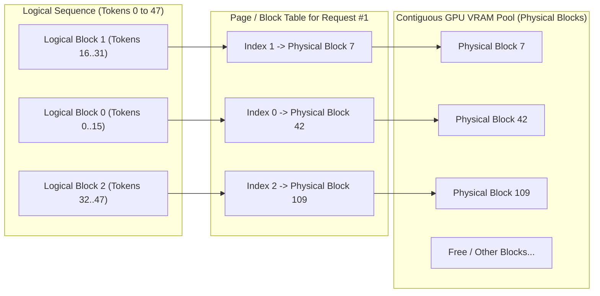
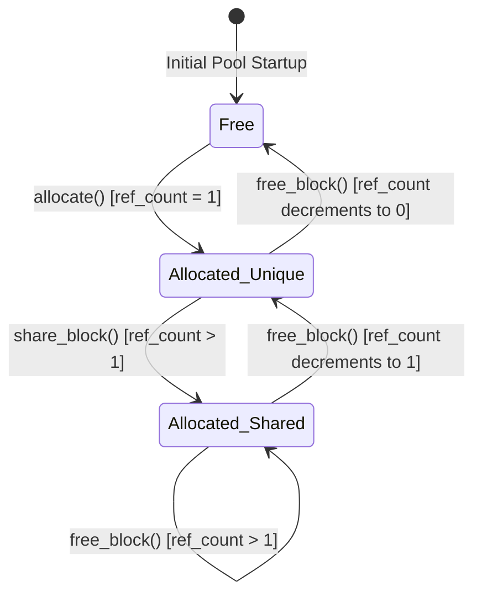

# Module 02: Memory Management Foundation

## 1. Learning Objectives
- **Understand Physical vs. Logical Memory Mapping**: Learn how Virtual Memory in OS kernels (pages, page tables, MMU) directly inspired **PagedAttention** in LLM runtimes.
- **Internal vs. External Memory Fragmentation**: Analyze why traditional contiguous tensor allocation fails catastrophically for dynamic batch LLM serving.
- **Implement a Physical Block Allocator**: Build a high-performance, deterministic `BlockAllocator` managing fixed-size blocks (e.g. 16 tokens/page) using a free list and intrusive bitsets / stacks.
- **Reference Counting & Copy-on-Write (COW)**: Design reference-counted blocks supporting instant zero-copy branch forks (speculative decoding, beam search, prefix sharing).
- **Comprehensive Mermaid Diagrams**: Visualize page tables, block states, and allocation sequences.

---

## 2. Conceptual Deep Dive: The Memory Fragmentation Problem

### Why Contiguous Allocation Fails for KV Caches

In traditional deep learning engines (like early Hugging Face Transformers or PyTorch implementations), each sequence pre-allocates a contiguous tensor in GPU memory for its maximum potential length:
$$\text{Allocated Buffer Size} = \text{Batch Size} \times \text{Max Context Length} \times 2 \times \text{Layers} \times \text{KV Heads} \times \text{Head Dim} \times \text{Bytes}$$

```text
Static Contiguous Allocation (Wasted VRAM):
[Token 1][Token 2][Token 3]...................[Reserved Padding Unused .................]
|<- Actual Content (3 tokens) ->| |<---------------- 4093 Wasted Tokens (99.9%) ------->|
```

This creates two fatal failure modes:
1. **Internal Fragmentation**: Space reserved inside an allocated chunk that remains unused because the model stopped generating early. In production, 60–80% of reserved VRAM is wasted padding.
2. **External Fragmentation**: Free memory is scattered in disjointed holes across VRAM. Even if 10 GB of total free VRAM exists, an incoming request requiring a contiguous 2 GB block will crash with CUDA Out-Of-Memory (OOM)!

### The OS Virtual Memory Analogy (PagedAttention)

In 1960, operating system designers faced the exact same problem with physical RAM. Their solution was **Paging**:
- Physical memory is split into fixed-size **Frames / Physical Blocks** (e.g. 4 KB in OS; 16 tokens in LLM KV cache).
- A process sees a contiguous **Logical Address Space**, mapped to non-contiguous physical blocks via a **Page Table**.
- In LLMs, a sequence thinks its past tokens $[0, 1, 2, \dots, N-1]$ are contiguous, but tokens $[0..15]$ reside in Physical Block #42, tokens $[16..31]$ in Physical Block #7, and tokens $[32..47]$ in Physical Block #109.



---

## 3. Data Structures & Block Reference Counting

When implementing Prefix Caching (Module 08) or Beam Search, multiple logical sequences will share the same physical blocks.
To make this safe without data races:
- Each physical block maintains an atomic reference counter: `ref_count`.
- When a new request shares a prefix with an existing request, the allocator simply increments `ref_count`.
- When a sequence releases a block, `ref_count` decrements. Only when `ref_count == 0` is the block returned to the `free_list`.
- If a sequence needs to append a new token to a shared block, **Copy-on-Write (COW)** triggers: a new unique physical block is allocated, the contents are copied, and the original block's refcount is decremented.



---

## 4. The Implementation Code

Below is the implementation for Module 02. You will write this into `src/memory/block_allocator.rs`.

```rust
use crate::error::{InferError, Result};
use std::collections::VecDeque;

#[derive(Debug, Clone, Copy, PartialEq, Eq, PartialOrd, Ord, Hash)]
pub struct PhysicalBlockId(pub usize);

#[derive(Debug, Clone)]
pub struct PhysicalBlock {
    pub id: PhysicalBlockId,
    pub ref_count: usize,
    pub block_size: usize,
    pub prefix_hash: Option<u64>,
}

impl PhysicalBlock {
    pub fn new(id: PhysicalBlockId, block_size: usize) -> Self {
        Self {
            id,
            ref_count: 0,
            block_size,
            prefix_hash: None,
        }
    }

    #[inline]
    pub fn is_free(&self) -> bool {
        self.ref_count == 0
    }
}

pub struct BlockAllocator {
    num_blocks: usize,
    pub block_size: usize,
    blocks: Vec<PhysicalBlock>,
    free_list: VecDeque<PhysicalBlockId>,
}

impl BlockAllocator {
    pub fn new(num_blocks: usize, block_size: usize) -> Self {
        let mut blocks = Vec::with_capacity(num_blocks);
        let mut free_list = VecDeque::with_capacity(num_blocks);

        for i in 0..num_blocks {
            let id = PhysicalBlockId(i);
            blocks.push(PhysicalBlock::new(id, block_size));
            free_list.push_back(id);
        }

        Self {
            num_blocks,
            block_size,
            blocks,
            free_list,
        }
    }

    #[inline]
    pub fn num_free_blocks(&self) -> usize {
        self.free_list.len()
    }

    #[inline]
    pub fn total_blocks(&self) -> usize {
        self.num_blocks
    }

    pub fn allocate(&mut self) -> Result<PhysicalBlockId> {
        match self.free_list.pop_front() {
            Some(id) => {
                let block = &mut self.blocks[id.0];
                debug_assert_eq!(block.ref_count, 0, "Allocated block must have ref_count == 0");
                block.ref_count = 1;
                block.prefix_hash = None;
                Ok(id)
            }
            None => Err(InferError::OutOfMemory {
                requested: 1,
                available: 0,
            }),
        }
    }

    pub fn allocate_exact(&mut self, count: usize) -> Result<Vec<PhysicalBlockId>> {
        if self.free_list.len() < count {
            return Err(InferError::OutOfMemory {
                requested: count,
                available: self.free_list.len(),
            });
        }

        let mut allocated = Vec::with_capacity(count);
        for _ in 0..count {
            let id = self.allocate()?;
            allocated.push(id);
        }
        Ok(allocated)
    }

    pub fn retain(&mut self, id: PhysicalBlockId) {
        let block = &mut self.blocks[id.0];
        debug_assert!(block.ref_count > 0, "Cannot retain an unallocated block");
        block.ref_count += 1;
    }

    pub fn free(&mut self, id: PhysicalBlockId) {
        let block = &mut self.blocks[id.0];
        debug_assert!(block.ref_count > 0, "Double-free detected on block {:?}", id);

        block.ref_count -= 1;
        if block.ref_count == 0 {
            block.prefix_hash = None;
            self.free_list.push_back(id);
        }
    }

    pub fn free_batch(&mut self, ids: &[PhysicalBlockId]) {
        for &id in ids {
            self.free(id);
        }
    }

    pub fn get_ref_count(&self, id: PhysicalBlockId) -> usize {
        self.blocks[id.0].ref_count
    }
}
```

---

## 5. Deep Code Walkthrough & Invariants

1. **Why `VecDeque` for the `free_list`?**
   - In modern memory allocators, block reuse policy impacts cache friendliness.
   - Pushing freed blocks to the back (`push_back`) and popping from the front (`pop_front`) implements a round-robin / FIFO policy, which prevents thrashing a single memory block.
   - For warm-cache prefix matching, LIFO (stack: `pop_back`) can also be configured to maximize temporal locality in GPU L2 cache.
2. **Atomic Invariant Guarantees**:
   - `debug_assert_eq!(block.ref_count, 0)`: Catching double-free and memory corruption at runtime in debug builds with zero overhead in release builds.
   - `allocate_exact` guarantees atomicity: it checks `free_list.len() < count` upfront. If not enough blocks are available, it fails immediately *before* mutating any state, preserving allocator consistency!

---

## 6. Exercises & Verification

1. **Unit Test Exercise**:
   - Write a unit test in `tests/test_module_02.rs`.
   - Verify physical block allocation, reference counting, and recycling to the free list.

2. **Failure-Case Exercise**:
   - Request more physical blocks than available in `BlockAllocator::allocate_exact`.
   - Verify that an `OutOfMemory` error is returned and no blocks are leaked.

3. **Measurement & Reasoning Exercise**:
   - Compute total allocatable blocks and token capacity for an 8 GB memory pool with 16 tokens/block (see `solutions/module_02.md`).
