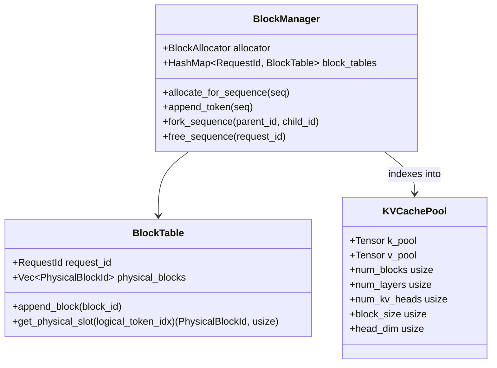
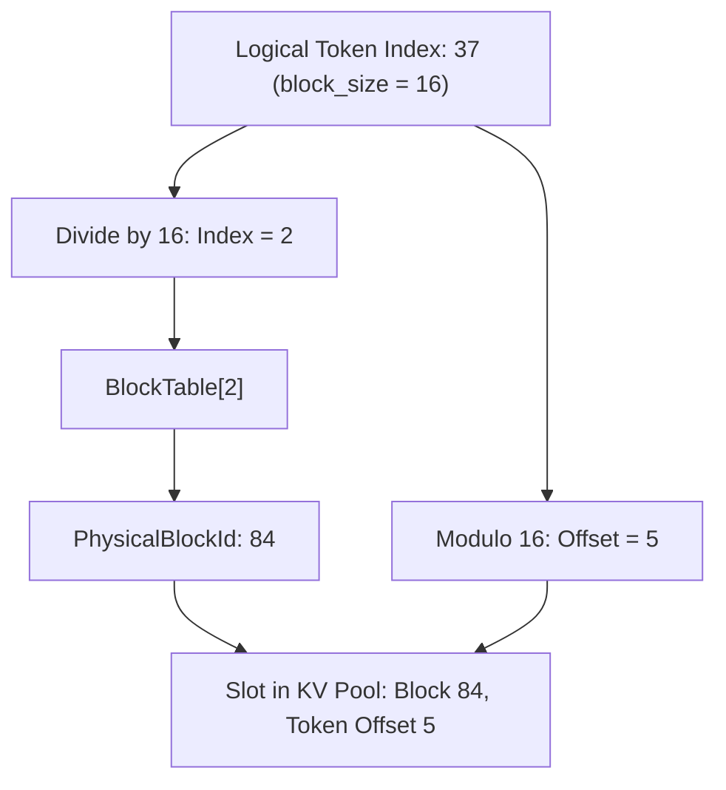
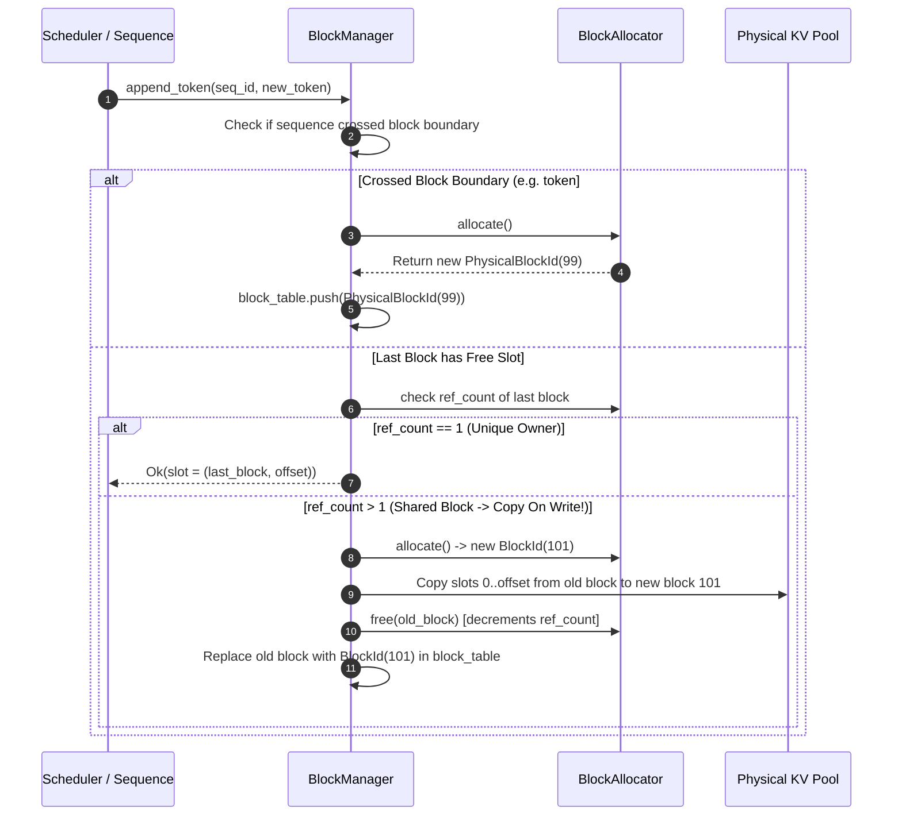

# Module 03: KV Cache & Paged Memory Layout

## 1. Learning Objectives
- **Master the Tensor Memory Layout for Paged KV Cache**: Deeply understand multi-dimensional tensor strata across layers, blocks, tokens, heads, and head dimensions.
- **Implement the Block Table**: Map per-sequence dynamic token streams to physical blocks.
- **Handle Dynamic Growth and Boundary Crossings**: Manage appending tokens across block boundaries ($15 \to 16$, $31 \to 32$) seamlessly.
- **Copy-on-Write (COW) Forking**: Implement sequence branching (e.g. beam search or speculative decoding) sharing past prefixes with zero memory copies until a new token is written.
- **Mermaid Memory Layout Diagrams**: Visualize the 5D/6D tensor shapes and physical block addressing arithmetic.

---

## 2. Conceptual Deep Dive: Memory Layout of Paged KV Tensors

### Why Naive Per-Sequence Tensors Cause GPU Memory Fragmentation
In a naive Transformer implementation, the KV cache for a sequence is allocated as a contiguous 4D tensor:
$$[\text{Layers}, 2, \text{SeqLen}, \text{NumKVHeads}, \text{HeadDim}]$$
Every time a new token is generated, the sequence must either:
1. Re-allocate a larger tensor and copy all past tokens (unacceptably slow $\mathcal{O}(N)$ copy per token).
2. Or pre-allocate for the worst-case context length (wasting gigabytes of VRAM).

### The Paged KV Cache Pool Tensor Layout
In **Paged KV Cache**, memory is allocated once at system startup as a massive contiguous tensor on the GPU (or pinned CPU memory).
For a model with $L$ layers, $B$ total physical blocks in the pool, block size $P$ (e.g. 16 tokens), $H_{KV}$ key-value heads, and head dimension $D$:

$$\text{K Cache Pool Shape: } [B, L, H_{KV}, P, D]$$
$$\text{V Cache Pool Shape: } [B, L, H_{KV}, P, D]$$

*(Note: Alternatively, K and V can be packed into $[B, L, 2, H_{KV}, P, D]$ or stored separately as two tensors).*



### Logical to Physical Address Translation Arithmetic

Given:
- `block_size` = 16
- Logical token position in sequence: `token_idx = 37`

We compute:
1. **Logical Block Index**: $\lfloor 37 / 16 \rfloor = 2$ (the 3rd block in the sequence's block table).
2. **Block Offset**: $37 \pmod{16} = 5$ (the 6th token slot within that physical block).
3. If the sequence's `block_table[2] = PhysicalBlockId(84)`, then the physical slot is:
   $$\text{Physical Address} = \text{Block } 84, \text{ Offset } 5$$



---

## 3. Dynamic Appending & Copy-On-Write (COW)

When a sequence generates a token:
1. Check if the current last block has space:
   $$\text{current\_len} \pmod{\text{block\_size}} \neq 0$$
   - If yes: space exists in the last physical block.
   - If no: the current block is completely full! We must allocate a **new physical block** from `BlockAllocator` and append it to the sequence's `BlockTable`.
2. **What if the last block is shared (`ref_count > 1`)?**
   - If another sequence is sharing this block (e.g. from prefix caching), we **cannot** write to it without corrupting the other sequence.
   - We must perform **Copy-on-Write (COW)**: allocate a fresh physical block, copy the existing tokens from the shared block into the fresh block, decrement the old block's refcount, and update the block table.



---

## 4. The Implementation Code

Below is the Rust code for Module 03. You will write this into `src/memory/kv_cache.rs`.

```rust
use crate::error::{InferError, Result};
use crate::memory::block_allocator::{BlockAllocator, PhysicalBlockId};
use crate::types::{RequestId, Sequence};
use candle_core::{DType, Device, Tensor};
use std::collections::HashMap;

/// Maps a single sequence's logical blocks to assigned physical memory blocks.
#[derive(Debug, Clone)]
pub struct BlockTable {
    pub request_id: RequestId,
    pub physical_blocks: Vec<PhysicalBlockId>,
}

impl BlockTable {
    pub fn new(request_id: RequestId) -> Self {
        Self {
            request_id,
            physical_blocks: Vec::new(),
        }
    }

    #[inline]
    pub fn append(&mut self, block: PhysicalBlockId) {
        self.physical_blocks.push(block);
    }

    /// Translates a logical token index to its physical block ID and token offset.
    pub fn translate(&self, token_idx: usize, block_size: usize) -> Result<(PhysicalBlockId, usize)> {
        let block_idx = token_idx / block_size;
        let offset = token_idx % block_size;

        self.physical_blocks.get(block_idx)
            .copied()
            .map(|b| (b, offset))
            .ok_or_else(|| InferError::Scheduler(format!(
                "Token index {} (logical block {}) out of bounds in block table of len {}",
                token_idx, block_idx, self.physical_blocks.len()
            )))
    }
}

/// Pre-allocated multi-dimensional physical tensor storage for Key and Value projections.
pub struct KVCachePool {
    /// K tensor shape: [num_blocks, num_layers, num_kv_heads, block_size, head_dim]
    pub k_pool: Tensor,
    /// V tensor shape: [num_blocks, num_layers, num_kv_heads, block_size, head_dim]
    pub v_pool: Tensor,
    pub num_blocks: usize,
    pub num_layers: usize,
    pub num_kv_heads: usize,
    pub block_size: usize,
    pub head_dim: usize,
    pub device: Device,
}

impl KVCachePool {
    /// Allocates the contiguous GPU or CPU tensor pool at startup.
    pub fn new(
        num_blocks: usize,
        num_layers: usize,
        num_kv_heads: usize,
        block_size: usize,
        head_dim: usize,
        dtype: DType,
        device: &Device,
    ) -> Result<Self> {
        let shape = (num_blocks, num_layers, num_kv_heads, block_size, head_dim);
        let k_pool = Tensor::zeros(shape, dtype, device)?;
        let v_pool = Tensor::zeros(shape, dtype, device)?;

        Ok(Self {
            k_pool,
            v_pool,
            num_blocks,
            num_layers,
            num_kv_heads,
            block_size,
            head_dim,
            device: device.clone(),
        })
    }
}

/// Central orchestrator combining the Physical BlockAllocator, Sequence BlockTables, and KV Pool.
pub struct BlockManager {
    pub allocator: BlockAllocator,
    pub block_tables: HashMap<RequestId, BlockTable>,
    pub block_size: usize,
}

impl BlockManager {
    pub fn new(num_blocks: usize, block_size: usize) -> Self {
        Self {
            allocator: BlockAllocator::new(num_blocks, block_size),
            block_tables: HashMap::new(),
            block_size,
        }
    }

    /// Allocates physical blocks required to house the initial prompt tokens of a sequence.
    pub fn allocate_for_prompt(&mut self, sequence: &Sequence) -> Result<()> {
        let num_tokens = sequence.prompt_tokens.len();
        if num_tokens == 0 {
            return Err(InferError::InvalidRequest("Prompt cannot be empty".to_string()));
        }

        let num_blocks_needed = (num_tokens + self.block_size - 1) / self.block_size;
        let physical_blocks = self.allocator.allocate_exact(num_blocks_needed)?;

        let mut table = BlockTable::new(sequence.id.clone());
        table.physical_blocks = physical_blocks;
        self.block_tables.insert(sequence.id.clone(), table);

        Ok(())
    }

    /// Ensures space exists for appending one new token during auto-regressive decode.
    pub fn append_token(&mut self, request_id: &RequestId, current_seq_len: usize) -> Result<(PhysicalBlockId, usize)> {
        let table = self.block_tables.get_mut(request_id)
            .ok_or_else(|| InferError::Scheduler(format!("No block table found for request {}", request_id)))?;

        let block_idx = current_seq_len / self.block_size;
        let offset = current_seq_len % self.block_size;

        // If we are starting a new block:
        if block_idx >= table.physical_blocks.len() {
            let new_block = self.allocator.allocate()?;
            table.append(new_block);
            return Ok((new_block, offset));
        }

        // If block already allocated, check for Copy-on-Write (COW) if shared
        let physical_block = table.physical_blocks[block_idx];
        if self.allocator.get_ref_count(physical_block) > 1 {
            // Must copy on write!
            let new_block = self.allocator.allocate()?;
            // Decrement old block refcount
            self.allocator.free(physical_block);
            table.physical_blocks[block_idx] = new_block;
            return Ok((new_block, offset));
        }

        Ok((physical_block, offset))
    }

    /// Duplicates a sequence's block table for parallel sampling or speculative verification (COW).
    pub fn fork_sequence(&mut self, parent_id: &RequestId, child_id: RequestId) -> Result<()> {
        let parent_table = self.block_tables.get(parent_id)
            .ok_or_else(|| InferError::Scheduler(format!("Parent request {} not found", parent_id)))?;

        let mut child_table = BlockTable::new(child_id.clone());
        for &block in &parent_table.physical_blocks {
            self.allocator.retain(block);
            child_table.append(block);
        }

        self.block_tables.insert(child_id, child_table);
        Ok(())
    }

    /// Deallocates all physical blocks associated with a completed sequence.
    pub fn free_sequence(&mut self, request_id: &RequestId) {
        if let Some(table) = self.block_tables.remove(request_id) {
            self.allocator.free_batch(&table.physical_blocks);
        }
    }
}
```

---

## 5. Deep Code Walkthrough & Architectural Invariants

1. **Ceil Division for Block Allocation**:
   - `(num_tokens + self.block_size - 1) / self.block_size`
   - If `block_size = 16`, 1 token requires $\lfloor 16/16 \rfloor = 1$ block. 16 tokens require 1 block. 17 tokens require 2 blocks. This prevents fencepost allocation errors.
2. **Zero-Copy Forking (`fork_sequence`)**:
   - Instead of duplicating multi-megabyte KV cache tensors, `fork_sequence` simply iterates through the parent's `physical_blocks` and calls `self.allocator.retain(block)`.
   - The child inherits the exact same physical blocks in nanoseconds!
   - When either sequence writes its next token, the COW logic in `append_token` isolates the branch automatically.

---

## 6. Exercises & Verification

1. **Verify COW in Unit Tests**:
   - Allocate a sequence with 16 tokens (1 block).
   - Fork the sequence into a child. Verify `ref_count == 2`.
   - Append a 17th token to the parent:
     - Verify parent allocated a new block for index 1.
     - Verify child's block table remains unchanged.
   - Free both sequences: verify all blocks return to `free_list` (`num_free_blocks() == total_blocks()`).
