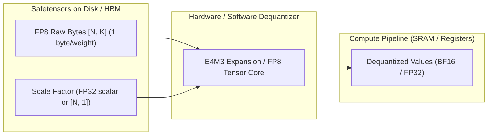
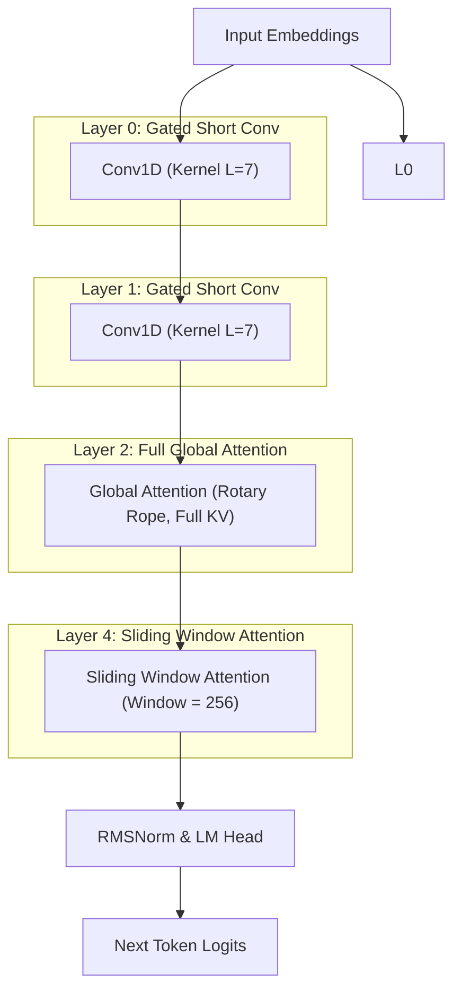

# Module 04: Model Loading & FP8 Representation

## 1. Learning Objectives
- **Understand FP8 Quantization Formats**: Differentiate between **E4M3** (higher precision for forward weights and activations) and **E5M2** (wider dynamic range for gradients / backward pass).
- **Master Weight Dequantization Mathematics**: Formula for per-tensor and per-channel FP8 scale factors: $W_{float} = W_{fp8} \times \text{scale}$.
- **Explore Model Architectures**:
  - Standard Causal Transformer (e.g. **Qwen3.5**).
  - Tri-Hybrid Architecture (**Liquid AI LFM3-1.7B**): 24 layers comprising 13 gated short convolutions, 5 sliding-window attentions, and 6 global attentions with sandwich normalization.
- **Implement a Safetensors Loader**: Stream weights directly into memory with zero-copy mmap.
- **Provide a Synthetic Model Generator**: Create valid FP8 safetensors weights dynamically for testing without needing multi-gigabyte Hugging Face downloads.

---

## 2. Conceptual Deep Dive: FP8 Numerics in Modern Inference

### Why FP8?
Modern NVIDIA architectures (Ada Lovelace, Hopper H100, Blackwell B200) include 4th/5th-generation Tensor Cores with hardware-accelerated **FP8 GEMM**.
- **Memory Footprint**: Cuts VRAM usage in half compared to BF16 (1 byte per parameter vs. 2 bytes).
- **Memory Bandwidth**: Doubles the effective memory bandwidth during the memory-bound decode phase.
- **Compute Throughput**: Hopper Tensor Cores provide $2\times$ the TFLOPs in FP8 compared to FP16/BF16.

### The Two IEEE 754-Derivative FP8 Formats

| Format | Sign Bits | Exponent Bits | Mantissa Bits | Dynamic Range | Min / Max Value | Primary Usage |
| :--- | :--- | :--- | :--- | :--- | :--- | :--- |
| **E4M3 (E4M3FN)** | 1 | 4 (bias 7) | 3 | $[-448, 448]$ | Smallest subnormal: $2^{-9}$ | **Weights & Activations (Inference)**. Maximizes precision at the expense of dynamic range. |
| **E5M2** | 1 | 5 (bias 15) | 2 | $[-57344, 57344]$ | Smallest subnormal: $2^{-16}$ | **Gradients & Scaling**. Same dynamic range as FP16, lower precision. |

### Dequantization Formulation
Because FP8 has a constrained range, weights are stored with a floating-point scaling factor:
$$W_{FP32} = \text{Dequantize}(W_{E4M3}) \times \text{weight\_scale}$$



---

## 3. Architecture Deep Dive: Liquid AI LFM3-1.7B Tri-Hybrid vs Qwen3.5

### Liquid AI LFM3-1.7B Architecture
Liquid AI's LFM3 breaks away from pure attention transformers. It uses a **tri-hybrid layer pattern** across its 24 layers:
1. **Gated Short Convolutions (13 layers)**:
   - Uses a 1D depthwise convolution with a small kernel cache ($L=7$).
   - Constant-time $\mathcal{O}(1)$ state updates; ideal for local n-gram syntax with zero KV cache growth!
2. **Sliding-Window Attention (5 layers)**:
   - Restricts attention context to a sliding window of 256 tokens (`sliding_window = 256`).
   - KV cache stays fixed at 256 tokens, bounding memory regardless of prompt length.
3. **Global Attention (6 layers)**:
   - Standard full causal Multi-Query / Grouped-Query Attention across the entire context.
4. **Sandwich Normalization**:
   - Applies RMSNorm both before and after the mixer layers to stabilize low-precision FP8 activations.



---

## 4. The Implementation Code

Below is the Rust code for Module 04. You will write this into `src/model/loader.rs` and `src/model/config.rs`.

### 4.1 Model Configuration: `src/model/config.rs`

```rust
use serde::{Deserialize, Serialize};

#[derive(Debug, Clone, Serialize, Deserialize)]
pub enum LayerType {
    #[serde(rename = "conv")]
    Conv,
    #[serde(rename = "sliding_attention")]
    SlidingAttention,
    #[serde(rename = "full_attention")]
    FullAttention,
}

#[derive(Debug, Clone, Serialize, Deserialize)]
pub struct ModelConfig {
    pub architectures: Vec<String>,
    pub vocab_size: usize,
    pub hidden_size: usize,
    pub intermediate_size: usize,
    pub num_hidden_layers: usize,
    pub num_attention_heads: usize,
    pub num_key_value_heads: usize,
    pub head_dim: usize,
    pub sliding_window: Option<usize>,
    pub conv_l_cache: Option<usize>,
    pub layer_types: Option<Vec<LayerType>>,
    pub norm_eps: f64,
    pub bos_token_id: u32,
    pub eos_token_id: u32,
}

impl ModelConfig {
    pub fn test_lfm3_config() -> Self {
        Self {
            architectures: vec!["Lfm3ForCausalLM".to_string()],
            vocab_size: 1000,
            hidden_size: 64,
            intermediate_size: 128,
            num_hidden_layers: 4,
            num_attention_heads: 4,
            num_key_value_heads: 2,
            head_dim: 16,
            sliding_window: Some(32),
            conv_l_cache: Some(7),
            layer_types: Some(vec![
                LayerType::Conv,
                LayerType::FullAttention,
                LayerType::Conv,
                LayerType::SlidingAttention,
            ]),
            norm_eps: 1e-5,
            bos_token_id: 1,
            eos_token_id: 2,
        }
    }
}
```

---

### 4.2 FP8 Dequantization & Weight Loader: `src/model/loader.rs`

```rust
use crate::error::Result;
use crate::model::config::ModelConfig;
use candle_core::{DType, Device, Tensor};
use std::collections::HashMap;

#[inline]
pub fn dequantize_e4m3_byte(byte: u8) -> f32 {
    let sign = (byte >> 7) & 1;
    let exp = (byte >> 3) & 0x0F;
    let mant = byte & 0x07;

    let sign_mul = if sign == 1 { -1.0 } else { 1.0 };

    if exp == 0 {
        sign_mul * (mant as f32 / 8.0) * (2.0f32.powi(-6))
    } else if exp == 0x0F && mant == 0x07 {
        f32::NAN
    } else {
        let normalized_exp = (exp as i32) - 7;
        sign_mul * (1.0 + mant as f32 / 8.0) * 2.0f32.powi(normalized_exp)
    }
}

pub struct FP8LinearWeight {
    pub raw_fp8_bytes: Vec<u8>,
    pub shape: Vec<usize>,
    pub scale: f32,
}

impl FP8LinearWeight {
    pub fn new(raw_fp8_bytes: Vec<u8>, shape: Vec<usize>, scale: f32) -> Self {
        Self { raw_fp8_bytes, shape, scale }
    }

    pub fn to_candle_tensor(&self, device: &Device) -> Result<Tensor> {
        let mut float_data = Vec::with_capacity(self.raw_fp8_bytes.len());
        for &byte in &self.raw_fp8_bytes {
            let float_val = dequantize_e4m3_byte(byte) * self.scale;
            float_data.push(float_val);
        }

        let tensor = Tensor::from_vec(float_data, self.shape.as_slice(), device)?;
        Ok(tensor)
    }
}

pub struct SyntheticModelLoader;

impl SyntheticModelLoader {
    pub fn generate_synthetic_weights(config: &ModelConfig, device: &Device) -> Result<HashMap<String, Tensor>> {
        let mut weights = HashMap::new();

        let emb = Tensor::randn(0.0f32, 0.02f32, (config.vocab_size, config.hidden_size), device)?;
        weights.insert("model.embed_tokens.weight".to_string(), emb);

        for l in 0..config.num_hidden_layers {
            let q = Tensor::randn(0.0f32, 0.02f32, (config.hidden_size, config.num_attention_heads * config.head_dim), device)?;
            let k = Tensor::randn(0.0f32, 0.02f32, (config.hidden_size, config.num_key_value_heads * config.head_dim), device)?;
            let v = Tensor::randn(0.0f32, 0.02f32, (config.hidden_size, config.num_key_value_heads * config.head_dim), device)?;
            let o = Tensor::randn(0.0f32, 0.02f32, (config.num_attention_heads * config.head_dim, config.hidden_size), device)?;

            weights.insert(format!("model.layers.{}.self_attn.q_proj.weight", l), q);
            weights.insert(format!("model.layers.{}.self_attn.k_proj.weight", l), k);
            weights.insert(format!("model.layers.{}.self_attn.v_proj.weight", l), v);
            weights.insert(format!("model.layers.{}.self_attn.o_proj.weight", l), o);

            let norm = Tensor::ones((config.hidden_size,), DType::F32, device)?;
            weights.insert(format!("model.layers.{}.input_layernorm.weight", l), norm.clone());
            weights.insert(format!("model.layers.{}.post_attention_layernorm.weight", l), norm);

            let gate = Tensor::randn(0.0f32, 0.02f32, (config.hidden_size, config.intermediate_size), device)?;
            let down = Tensor::randn(0.0f32, 0.02f32, (config.intermediate_size, config.hidden_size), device)?;
            weights.insert(format!("model.layers.{}.mlp.gate_proj.weight", l), gate);
            weights.insert(format!("model.layers.{}.mlp.down_proj.weight", l), down);
        }

        let head = Tensor::randn(0.0f32, 0.02f32, (config.vocab_size, config.hidden_size), device)?;
        weights.insert("lm_head.weight".to_string(), head);

        Ok(weights)
    }
}
```

---

## 5. Exercises & Verification

1. **Unit Test Exercise**:
   - Write a unit test in `tests/test_module_04.rs`.
   - Verify IEEE 754 FP8 E4M3 dequantization for normal values `1.0`, `-1.0`, and the smallest subnormal value.

2. **Failure-Case Exercise**:
   - Test that the E4M3 bit pattern `0b01111111` correctly decodes to IEEE 754 `NaN`.

3. **Measurement & Reasoning Exercise**:
   - Compute memory reduction and footprint when quantizing a 7B model from FP16 to FP8 (see `solutions/module_04.md`).
