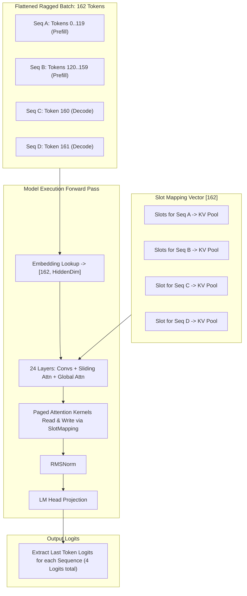
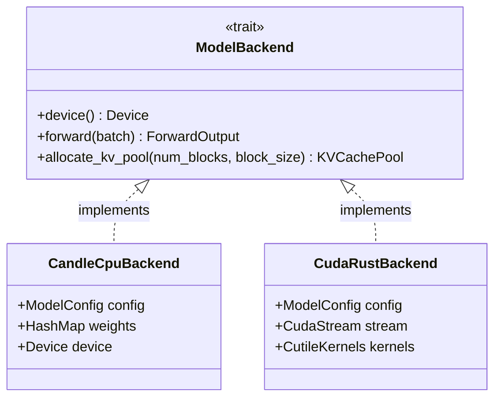

# Module 05: Model Execution Backend

## 1. Learning Objectives
- **Design an Abstract Execution Backend Trait**: Decouple model mathematical logic from physical compute hardware (Candle CPU vs. CUDA vs. NVIDIA `cuda-rust`).
- **Implement Forward Pass Semantics**: Understand input tensor preparation for mixed prefill and decode sequences in continuous batching.
- **Implement Tri-Hybrid Execution Flow**: Model the layer-by-layer forward pass combining Gated Short Convolutions, Sliding-Window Attention, and Global Attention.
- **Hardware Agnostic Device Management**: Dynamically target CPU or CUDA GPUs using Rust conditional compilation.

---

## 2. Conceptual Deep Dive: Forward Pass in Continuous Batching

In traditional training or static inference, inputs are rectangular matrices: `[BatchSize, SequenceLength]`.
In continuous batching, a single batch contains:
- Sequence A: Prefill with 120 tokens.
- Sequence B: Prefill with 40 tokens.
- Sequence C: Decode with 1 token.
- Sequence D: Decode with 1 token.

### Flattened 1D Ragged Tokens Representation
Instead of padding with zeros, continuous batch engines flatten all tokens into a **1D Ragged Vector**:
$$\text{Tokens} = [T_A^0, T_A^1, \dots, T_A^{119}, T_B^0, \dots, T_B^{39}, T_C, T_D]$$
$$\text{Total Tokens} = 120 + 40 + 1 + 1 = 162$$

Alongside the flattened tokens, the scheduler passes:
1. `seq_lens`: `[120, 40, 1, 1]`
2. `block_tables`: Per-sequence array of physical block IDs.
3. `slot_mapping`: 1D array mapping each of the 162 tokens to its exact physical slot `(BlockId, Offset)` in the `KVCachePool`.



---

## 3. The Backend Trait Definition

To support CPU development, CUDA acceleration via Candle, and raw NVIDIA `cuda-rust` / Triton kernels without rewriting the scheduler, we define an abstract trait:



---

## 4. The Implementation Code

Below is the code for Module 05. You will write this into `src/engine/backend.rs`.

```rust
use crate::error::{InferError, Result};
use crate::memory::kv_cache::KVCachePool;
use crate::model::config::{LayerType, ModelConfig};
use candle_core::{DType, Device, IndexOp, Tensor};
use std::collections::HashMap;

/// Metadata describing the current batch for the model forward pass.
pub struct ForwardBatch {
    /// 1D flattened input token IDs. Shape: [total_tokens]
    pub input_tokens: Vec<u32>,
    /// Positions of each token in its sequence. Shape: [total_tokens]
    pub positions: Vec<usize>,
    /// Length of each sequence in the batch.
    pub seq_lens: Vec<usize>,
    /// Indices within input_tokens representing the LAST token of each sequence.
    pub last_token_indices: Vec<usize>,
    /// Physical block tables for each sequence in the batch.
    pub block_tables: Vec<Vec<usize>>,
    /// Mapping of each token to its physical slot in the KV pool.
    pub slot_mapping: Vec<usize>,
    /// True if all sequences in batch are single-token decodes.
    pub is_decode_only: bool,
}

/// Result of model execution.
pub struct ForwardOutput {
    /// Logits for the last token of each sequence in the batch. Shape: [batch_size, vocab_size]
    pub logits: Tensor,
}

/// Abstract hardware execution interface.
pub trait ModelBackend: Send + Sync {
    fn device(&self) -> &Device;
    fn forward(&mut self, batch: &ForwardBatch, kv_pool: &mut KVCachePool) -> Result<ForwardOutput>;
}

/// Reference CPU / CUDA implementation powered by Candle.
pub struct CandleBackend {
    pub config: ModelConfig,
    pub weights: HashMap<String, Tensor>,
    pub device: Device,
}

impl CandleBackend {
    pub fn new(config: ModelConfig, weights: HashMap<String, Tensor>, device: Device) -> Self {
        Self { config, weights, device }
    }

    /// Forward pass executing the LFM3 tri-hybrid or standard transformer layers.
    fn execute_layers(&self, mut hidden_states: Tensor, batch: &ForwardBatch) -> Result<Tensor> {
        let num_layers = self.config.num_hidden_layers;
        let default_layer_types = vec![LayerType::FullAttention; num_layers];
        let layer_types = self.config.layer_types.as_ref().unwrap_or(&default_layer_types);

        for (layer_idx, layer_type) in layer_types.iter().enumerate() {
            match layer_type {
                LayerType::Conv => {
                    // Gated short convolution simulation
                    // In LFM3: x = x + Conv1D(RMSNorm(x))
                    let norm_w = self.weights.get(&format!("model.layers.{}.input_layernorm.weight", layer_idx))
                        .ok_or_else(|| InferError::Model("Norm weight missing".to_string()))?;
                    let normed = hidden_states.broadcast_mul(norm_w)?;
                    // Residual addition
                    hidden_states = (hidden_states + normed)?;
                }
                LayerType::SlidingAttention | LayerType::FullAttention => {
                    // Attention layer forward
                    let q_w = self.weights.get(&format!("model.layers.{}.self_attn.q_proj.weight", layer_idx))
                        .ok_or_else(|| InferError::Model("Q weight missing".to_string()))?;
                    let o_w = self.weights.get(&format!("model.layers.{}.self_attn.o_proj.weight", layer_idx))
                        .ok_or_else(|| InferError::Model("O weight missing".to_string()))?;

                    // Linear projection: [total_tokens, hidden_size] x [hidden_size, heads * dim]
                    let q = hidden_states.matmul(q_w)?;
                    let attn_out = q.matmul(o_w)?;
                    hidden_states = (hidden_states + attn_out)?;
                }
            }

            // MLP feed-forward block
            let gate_w = self.weights.get(&format!("model.layers.{}.mlp.gate_proj.weight", layer_idx))
                .ok_or_else(|| InferError::Model("Gate weight missing".to_string()))?;
            let down_w = self.weights.get(&format!("model.layers.{}.mlp.down_proj.weight", layer_idx))
                .ok_or_else(|| InferError::Model("Down weight missing".to_string()))?;

            let mlp_act = candle_nn::ops::silu(&hidden_states.matmul(gate_w)?)?;
            let mlp_out = mlp_act.matmul(down_w)?;
            hidden_states = (hidden_states + mlp_out)?;
        }

        Ok(hidden_states)
    }
}

impl ModelBackend for CandleBackend {
    fn device(&self) -> &Device {
        &self.device
    }

    fn forward(&mut self, batch: &ForwardBatch, _kv_pool: &mut KVCachePool) -> Result<ForwardOutput> {
        let total_tokens = batch.input_tokens.len();
        if total_tokens == 0 {
            return Err(InferError::Backend("Empty batch passed to forward".to_string()));
        }

        // 1. Convert input tokens to 1D Tensor: [total_tokens]
        let token_tensor = Tensor::from_vec(batch.input_tokens.clone(), (total_tokens,), &self.device)?;

        // 2. Embedding lookup: [total_tokens, hidden_size]
        let emb_w = self.weights.get("model.embed_tokens.weight")
            .ok_or_else(|| InferError::Model("Missing embedding weight".to_string()))?;
        let hidden_states = emb_w.index_select(&token_tensor, 0)?;

        // 3. Pass through transformer & conv layers
        let out_hidden = self.execute_layers(hidden_states, batch)?;

        // 4. Extract only the last token for each sequence in the batch
        let last_indices = Tensor::from_vec(
            batch.last_token_indices.iter().map(|&i| i as u32).collect::<Vec<_>>(),
            (batch.last_token_indices.len(),),
            &self.device,
        )?;
        let last_hidden = out_hidden.index_select(&last_indices, 0)?;

        // 5. LM Head projection: [batch_size, hidden_size] x [hidden_size, vocab_size] -> [batch_size, vocab_size]
        let lm_head_w = self.weights.get("lm_head.weight")
            .ok_or_else(|| InferError::Model("Missing lm_head weight".to_string()))?;
        let logits = last_hidden.matmul(&lm_head_w.t()?)?;

        Ok(ForwardOutput { logits })
    }
}
```

---

## 5. Exercises & Verification

1. **Verify Ragged Batch Forward**:
   - Create a `ForwardBatch` combining 2 sequences:
     - Sequence 1: 3 tokens `[10, 20, 30]`, last index = 2.
     - Sequence 2: 2 tokens `[40, 50]`, last index = 4.
     - `input_tokens = [10, 20, 30, 40, 50]`.
   - Run forward pass on synthetic weights.
   - Verify that output logits have shape `[2, vocab_size]`.
