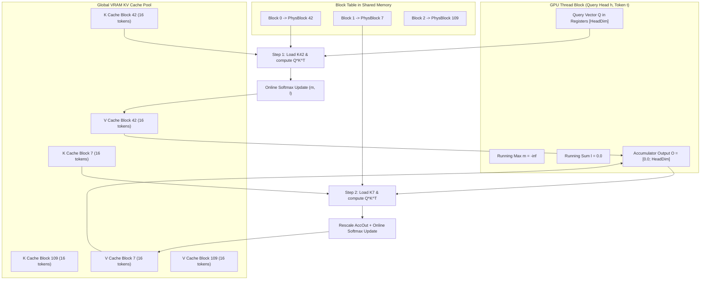

# Module 06: Attention Kernels & Paged Attention

## 1. Learning Objectives
- **Demystify the PagedAttention Algorithm**: Understand the non-contiguous memory access pattern during Q * K^T and Softmax * V.
- **Master the Online Softmax Technique**: Compute numerically stable softmax incrementally across streaming blocks without storing intermediate attention matrices in HBM.
- **NVIDIA `cuda-rust` & Hardware Kernel Paradigms**:
  - `cutile-rs` Tile programming model: Tile partitioning and borrow checking across device boundaries.
  - `cuda-oxide` SIMT programming model: Direct thread/warp indexing in Rust compiled to PTX.
- **Implement a Pure Rust / Candle Reference Kernel**: An exact mathematical reference for CPU verification and testing.
- **Mermaid Memory Access Diagrams**: Trace how threads map to physical block tables and memory banks.

---

## 2. Conceptual Deep Dive: The PagedAttention Kernel

### The Standard Attention Bottleneck
In standard Multi-Head Attention:
$$\text{Attention}(Q, K, V) = \text{Softmax}\left(\frac{Q K^T}{\sqrt{d_k}}\right) V$$
In standard CUDA kernels, $K$ and $V$ are assumed to be contiguous arrays in memory. If sequence tokens are scattered across physical blocks $42 \to 7 \to 109$, standard FlashAttention kernels cannot read them directly!

### How PagedAttention Works
PagedAttention redesigns the GPU kernel thread hierarchy:
1. Each GPU **Thread Block** is assigned to compute attention for **one query token** and **one attention head**.
2. Instead of iterating over contiguous pointer offsets, the thread block reads the sequence's **Block Table**:
   - Iterates block-by-block: `physical_block = block_table[b]`.
   - Fetches the 16 tokens stored in `K_pool[physical_block]`.
   - Computes local dot products $Q \cdot K^T$.
   - Updates running softmax statistics ($m$, $l$) using the **Online Softmax Algorithm**.
   - Accumulates weighted value vectors from `V_pool[physical_block]`.



---

## 3. The Online Softmax Algorithm

To avoid materializing the entire $[1, \text{ContextLength}]$ attention score matrix in memory, PagedAttention uses the online softmax formulation (Milakov & Gimelshein, 2018):

Given current running maximum $m^{(j-1)}$, running normalizer $l^{(j-1)}$, and partial attention output $O^{(j-1)}$:
When processing a new block of scores $x_i$ ($i \in \text{block } j$):
1. Compute local block maximum:
   $$\tilde{m} = \max_{i} x_i$$
2. Update new global maximum:
   $$m^{(j)} = \max(m^{(j-1)}, \tilde{m})$$
3. Compute scale factors:
   $$\alpha = e^{m^{(j-1)} - m^{(j)}}, \quad \beta_i = e^{x_i - m^{(j)}}$$
4. Update normalizer:
   $$l^{(j)} = \alpha \cdot l^{(j-1)} + \sum_i \beta_i$$
5. Rescale and accumulate output:
   $$O^{(j)} = \alpha \cdot O^{(j-1)} + \sum_i \beta_i \cdot V_i$$

At the final block, the true attention output is simply:
$$\text{Final Output} = \frac{O^{(N)}}{l^{(N)}}$$

---

## 4. CUDA Rust Kernel Integration: `cutile-rs` & `cuda-oxide`

NVIDIA provides two tracks for writing native GPU kernels in Rust.

### Toolchain Requirements

| Property | cuTile Rust (`cutile-rs`) | CUDA Oxide (`cuda-oxide`) |
| :--- | :--- | :--- |
| **Programming Model** | Tile programming (compiler manages warps & shared memory) | SIMT (thread/warp indexing) |
| **Rust Toolchain** | Stable Rust 1.89+ | Pinned Nightly toolchain |
| **CUDA Requirement** | CUDA 13.3+ (uses CUDA Tile IR) | CUDA 12.x+ toolkit |
| **Build Tooling** | Standard `cargo build` | `cargo-oxide` subcommand |
| **Maturity Status** | Published on crates.io, active research | Early alpha research project |

### 4.1 cuTile-rs Tile Programming Model

In `cutile-rs`, GPU kernels operate on register-resident `Tile<T, S>` fragments loaded from global memory tensors `Tensor<T, S>`.
A kernel module uses `#[cutile::module]`. A kernel entry point uses `#[cutile::entry()]`.

#### Online Softmax Formulation
Let running state after step $j-1$ be maximum $m^{(j-1)}$, normalizer $l^{(j-1)}$, and unnormalized output $O^{(j-1)}$.
For new score tile $S^{(j)}$:
1. Block maximum:
   $$\tilde{m} = \max(S^{(j)})$$
2. Updated global maximum:
   $$m^{(j)} = \max(m^{(j-1)}, \tilde{m})$$
3. Correction factors:
   $$\alpha = e^{m^{(j-1)} - m^{(j)}}, \quad P = e^{S^{(j)} - m^{(j)}}$$
4. Normalizer update:
   $$l^{(j)} = l^{(j-1)} \cdot \alpha + \sum P$$
5. Accumulator update:
   $$O^{(j)} = O^{(j-1)} \cdot \alpha + P \cdot V^{(j)}$$
6. Final output after all blocks:
   $$\text{Output} = \frac{O}{l}$$

#### Block-Table Gather Status in `cutile-rs`
cuTile-rs today supports structured tensor partitions (`Partition<T, S>`) along uniform coordinate grids. cuTile-rs does not support arbitrary indirect table lookups or block-table index gathers across non-contiguous physical pages in safe DSL code today. We state this limitation clearly. The CPU reference implementation in `src/engine/paged_attention.rs` remains the working compiled code. The GPU tile kernel below is a design sketch, not compiled.

```rust
// Design sketch, not compiled.
// Requires indirect page gather support in cuTile-rs.
#[cutile::module]
mod paged_attention_kernel {
    use cutile::core::*;

    #[cutile::entry()]
    fn paged_attention_decode<
        const BM: i32, // Query tokens per program (1 for decode)
        const BN: i32, // KV tokens per block (e.g. 16)
        const D: i32,  // Head dimension (e.g. 128)
    >(
        out: &mut Tensor<f32, { [1, BM, D] }>,
        q: &Tensor<f32, { [-1, -1, -1, -1] }>,
        k_pool: &Tensor<f32, { [-1, -1, -1, -1] }>,
        v_pool: &Tensor<f32, { [-1, -1, -1, -1] }>,
        num_blocks: i32,
        qk_scale: f32,
    ) {
        let pid0 = program_id(0);
        let h = q.shape()[1];
        let batch_idx = pid0 / h;
        let head_idx = pid0 % h;

        // Scale factor for exponentiation
        let qk_scale_tile: Tile<f32, { [BM, BN] }> =
            broadcast_scalar(qk_scale, shape![BM, BN]);

        // Online softmax running state
        let mut m_i: Tile<f32, { [BM, 1] }> = constant(f32::NEG_INFINITY, shape![BM, 1]);
        let mut l_i: Tile<f32, { [BM, 1] }> = constant(0.0f32, shape![BM, 1]);
        let mut acc: Tile<f32, { [BM, D] }> = constant(0.0f32, shape![BM, D]);

        // Load query tile: [BM, D]
        let q_part: Partition<f32, { [1, 1, BM, D] }> = q.partition(shape![1, 1, BM, D]);
        let tq: Tile<f32, { [BM, D] }> = q_part
            .load([batch_idx, head_idx, 0i32, 0i32])
            .reshape(shape![BM, D]);

        let k_part = k_pool.partition(shape![1, 1, BN, D]);
        let v_part = v_pool.partition(shape![1, 1, BN, D]);

        // Loop over physical blocks
        for b in 0i32..num_blocks {
            // Load key tile: [BN, D]
            let k_tile: Tile<f32, { [BN, D] }> = k_part
                .load([b, head_idx, 0i32, 0i32])
                .reshape(shape![BN, D]);

            // Compute Q * K^T: [BM, BN]
            let k_tile_t: Tile<f32, { [D, BN] }> = k_tile.transpose();
            let mut qk: Tile<f32, { [BM, BN] }> = constant(0.0f32, shape![BM, BN]);
            qk = mma(tq, k_tile_t, qk);
            qk = qk * qk_scale_tile;

            // Online softmax update: running max
            let qk_max: Tile<f32, { [BM] }> = reduce_max(qk, 1i32);
            let qk_max: Tile<f32, { [BM, 1] }> = qk_max.reshape(shape![BM, 1]);
            let m_next: Tile<f32, { [BM, 1] }> = max_tile(m_i, qk_max);

            // Rescale factor alpha = exp(m_i - m_next)
            let alpha: Tile<f32, { [BM, 1] }> = exp(m_i - m_next);
            let p: Tile<f32, { [BM, BN] }> = exp(qk - m_next.broadcast(shape![BM, BN]));

            // Update normalizer l_i = l_i * alpha + sum(p)
            let l_p: Tile<f32, { [BM] }> = reduce_sum(p, 1i32);
            let l_p: Tile<f32, { [BM, 1] }> = l_p.reshape(shape![BM, 1]);
            l_i = l_i * alpha + l_p;

            // Rescale accumulator and add p * v
            acc = acc * alpha.broadcast(shape![BM, D]);
            let v_tile: Tile<f32, { [BN, D] }> = v_part
                .load([b, head_idx, 0i32, 0i32])
                .reshape(shape![BN, D]);
            acc = mma(p, v_tile, acc);

            m_i = m_next;
        }

        // Final normalization: acc / l_i
        acc = true_div(acc, l_i.broadcast(shape![BM, D]));
        out.store(acc.reshape(shape![1, BM, D]));
    }
}
```

### 4.2 SIMT Model (`cuda-oxide`)
The `cuda-oxide` track uses a custom `rustc` codegen backend. It compiles SIMT kernels written in Rust to PTX. The kernel uses `DisjointSlice<T>` to enforce safe per-thread mutable borrowing at compile time.

### 4.3 Comparison with Hugging Face Grout
Hugging Face developed Grout (https://github.com/huggingface/grout) as a dedicated Qwen3 inference engine written in Rust using `cutile-rs` 0.4.0. Grout focuses on single-sequence execution throughput. It compiles whole forward execution into a `StepGraph` IR and captures decode passes into CUDA graphs. cuBLAS handles linear projections, while custom cuTile kernels execute layer normalization, RoPE, and FlashAttention. In contrast, TinBox is an educational multi-tenant runtime. TinBox implements continuous batching, an asynchronous HTTP serving layer with SSE, physical page allocation, and prefix caching with RadixAttention trees.

---

## 5. The Reference Implementation Code

Below is the CPU/Candle reference implementation for Module 06. You will write this into `src/engine/paged_attention.rs`.

```rust
use crate::error::Result;
use candle_core::{IndexOp, Tensor};

pub struct PagedAttentionRef;

impl PagedAttentionRef {
    pub fn forward_decode(
        q: &Tensor,
        k_pool: &Tensor,
        v_pool: &Tensor,
        block_table: &[usize],
        seq_len: usize,
        block_size: usize,
    ) -> Result<Tensor> {
        let (_num_heads, head_dim) = q.dims2()?;
        let scale = 1.0f32 / (head_dim as f32).sqrt();

        let mut gathered_k = Vec::new();
        let mut gathered_v = Vec::new();

        let mut tokens_remaining = seq_len;
        for &block_id in block_table {
            if tokens_remaining == 0 {
                break;
            }
            let valid_tokens_in_block = tokens_remaining.min(block_size);

            let k_block = k_pool.i((block_id, .., ..valid_tokens_in_block, ..))?;
            let v_block = v_pool.i((block_id, .., ..valid_tokens_in_block, ..))?;

            gathered_k.push(k_block);
            gathered_v.push(v_block);

            tokens_remaining -= valid_tokens_in_block;
        }

        let all_k = Tensor::cat(&gathered_k, 1)?;
        let all_v = Tensor::cat(&gathered_v, 1)?;

        let q_scaled = (q * (scale as f64))?;
        let q_3d = q_scaled.unsqueeze(1)?;
        let all_k_t = all_k.transpose(1, 2)?;
        let attn_scores = q_3d.matmul(&all_k_t)?.squeeze(1)?;

        let attn_weights = candle_nn::ops::softmax(&attn_scores, 1)?;

        let weights_3d = attn_weights.unsqueeze(1)?;
        let output = weights_3d.matmul(&all_v)?.squeeze(1)?;

        Ok(output)
    }
}
```

---

## 6. Exercises & Verification

1. **Unit Test Exercise**:
   - Write a unit test in `tests/test_module_06.rs`.
   - Verify non-contiguous physical block decoding in `PagedAttentionRef::forward_decode`.

2. **Failure-Case Exercise**:
   - Test edge cases where sequence length is smaller than or equal to a single block.

3. **Measurement & Reasoning Exercise**:
   - Compute memory savings of tiled online softmax versus standard attention matrix materialization (see `solutions/module_06.md`).
