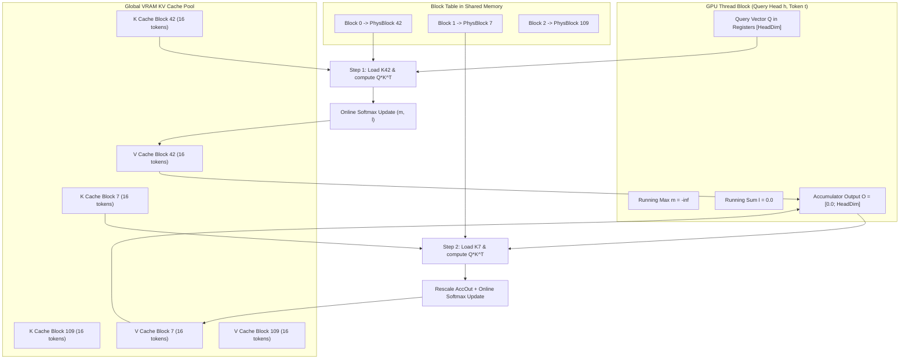

# Module 06: Attention Kernels & Paged Attention

## 1. Learning Objectives
- **Demystify the PagedAttention Algorithm**: Understand the non-contiguous memory access pattern during Q * K^T and Softmax * V.
- **Master the Online Softmax Technique**: Compute numerically stable softmax incrementally across streaming blocks without storing intermediate attention matrices in HBM.
- **NVIDIA `cuda-rust` & Hardware Kernel Paradigms**:
  - `cutile-rs` Tile programming model: Tile partitioning and borrow checking across device boundaries.
  - `cuda-oxide` SIMT programming model: Direct thread/warp indexing in Rust compiled to PTX.
- **Implement a Pure Rust / Candle Reference Kernel**: An exact mathematical reference for CPU verification and testing.
- **Mermaid Memory Access Diagrams**: Trace how threads map to physical block tables and memory banks.

---

## 2. Conceptual Deep Dive: The PagedAttention Kernel

### The Standard Attention Bottleneck
In standard Multi-Head Attention:
$$\text{Attention}(Q, K, V) = \text{Softmax}\left(\frac{Q K^T}{\sqrt{d_k}}\right) V$$
In standard CUDA kernels, $K$ and $V$ are assumed to be contiguous arrays in memory. If sequence tokens are scattered across physical blocks $42 \to 7 \to 109$, standard FlashAttention kernels cannot read them directly!

### How PagedAttention Works
PagedAttention redesigns the GPU kernel thread hierarchy:
1. Each GPU **Thread Block** is assigned to compute attention for **one query token** and **one attention head**.
2. Instead of iterating over contiguous pointer offsets, the thread block reads the sequence's **Block Table**:
   - Iterates block-by-block: `physical_block = block_table[b]`.
   - Fetches the 16 tokens stored in `K_pool[physical_block]`.
   - Computes local dot products $Q \cdot K^T$.
   - Updates running softmax statistics ($m$, $l$) using the **Online Softmax Algorithm**.
   - Accumulates weighted value vectors from `V_pool[physical_block]`.



---

## 3. The Online Softmax Algorithm

To avoid materializing the entire $[1, \text{ContextLength}]$ attention score matrix in memory, PagedAttention uses the online softmax formulation (Milakov & Gimelshein, 2018):

Given current running maximum $m^{(j-1)}$, running normalizer $l^{(j-1)}$, and partial attention output $O^{(j-1)}$:
When processing a new block of scores $x_i$ ($i \in \text{block } j$):
1. Compute local block maximum:
   $$\tilde{m} = \max_{i} x_i$$
2. Update new global maximum:
   $$m^{(j)} = \max(m^{(j-1)}, \tilde{m})$$
3. Compute scale factors:
   $$\alpha = e^{m^{(j-1)} - m^{(j)}}, \quad \beta_i = e^{x_i - m^{(j)}}$$
4. Update normalizer:
   $$l^{(j)} = \alpha \cdot l^{(j-1)} + \sum_i \beta_i$$
5. Rescale and accumulate output:
   $$O^{(j)} = \alpha \cdot O^{(j-1)} + \sum_i \beta_i \cdot V_i$$

At the final block, the true attention output is simply:
$$\text{Final Output} = \frac{O^{(N)}}{l^{(N)}}$$

---

## 4. CUDA Rust Kernel Integration: `cutile-rs` & `cuda-oxide`

NVIDIA's `cuda-rust` platform allows writing GPU kernels directly in idiomatic Rust:

### Option A: Tile Programming Model (`cutile-rs`)
```rust
// Concept illustration of cutile-rs Tile Kernel
#[cutile::kernel]
fn paged_attention_tile_kernel(
    q: TileView<f32, [1, HEAD_DIM]>,
    k_blocks: BlockTableView<f32, [BLOCK_SIZE, HEAD_DIM]>,
    v_blocks: BlockTableView<f32, [BLOCK_SIZE, HEAD_DIM]>,
    mut out: TileViewMut<f32, [1, HEAD_DIM]>
) {
    let mut acc = Tile::zeros([1, HEAD_DIM]);
    let mut m = -f32::INFINITY;
    let mut l = 0.0f32;

    for (k_tile, v_tile) in k_blocks.zip(v_blocks) {
        let scores = q.matmul(k_tile.t()) * (1.0 / (HEAD_DIM as f32).sqrt());
        // Online softmax updates executed on whole sub-tiles
        ...
    }
    out.store(acc / l);
}
```

### Option B: SIMT Model (`cuda-oxide`)
Compiles device functions with Rust ownership rules into PTX, managing thread IDs (`thread_idx_x`) and shared memory directly.

---

## 5. The Reference Implementation Code

Below is the CPU/Candle reference implementation for Module 06. You will write this into `src/engine/paged_attention.rs`.

```rust
use crate::error::Result;
use candle_core::{DType, Device, Tensor};

/// Pure reference implementation of PagedAttention for CPU execution and mathematical testing.
pub struct PagedAttentionRef;

impl PagedAttentionRef {
    /// Computes attention for a single decode query vector against non-contiguous paged KV cache.
    ///
    /// - `q`: Query vector for this sequence [num_heads, head_dim]
    /// - `k_pool`: Global K cache pool [num_blocks, num_kv_heads, block_size, head_dim]
    /// - `v_pool`: Global V cache pool [num_blocks, num_kv_heads, block_size, head_dim]
    /// - `block_table`: Array of physical block IDs holding past tokens
    /// - `seq_len`: Total number of valid past tokens in the sequence
    /// - `block_size`: Number of tokens per block (e.g. 16)
    pub fn forward_decode(
        q: &Tensor,
        k_pool: &Tensor,
        v_pool: &Tensor,
        block_table: &[usize],
        seq_len: usize,
        block_size: usize,
    ) -> Result<Tensor> {
        let (num_heads, head_dim) = q.dims2()?;
        let scale = 1.0f32 / (head_dim as f32).sqrt();

        // 1. Gather all past K and V slices for this sequence across physical blocks
        let mut gathered_k = Vec::new();
        let mut gathered_v = Vec::new();

        let mut tokens_remaining = seq_len;
        for &block_id in block_table {
            if tokens_remaining == 0 {
                break;
            }
            let valid_tokens_in_block = tokens_remaining.min(block_size);

            // Slice out valid tokens from this physical block: [num_kv_heads, valid_tokens, head_dim]
            let k_block = k_pool.i((block_id, .., ..valid_tokens_in_block, ..))?;
            let v_block = v_pool.i((block_id, .., ..valid_tokens_in_block, ..))?;

            gathered_k.push(k_block);
            gathered_v.push(v_block);

            tokens_remaining -= valid_tokens_in_block;
        }

        // Concatenate along the token dimension: [num_kv_heads, seq_len, head_dim]
        let all_k = Tensor::cat(&gathered_k, 1)?;
        let all_v = Tensor::cat(&gathered_v, 1)?;

        // 2. Compute Q * K^T: [num_heads, head_dim] x [num_heads, head_dim, seq_len] -> [num_heads, seq_len]
        // (Assuming standard GQA / MHA head alignment)
        let q_scaled = (q * (scale as f64))?;
        let q_3d = q_scaled.unsqueeze(1)?; // [num_heads, 1, head_dim]
        let all_k_t = all_k.transpose(1, 2)?; // [num_heads, head_dim, seq_len]
        let attn_scores = q_3d.matmul(&all_k_t)?.squeeze(1)?; // [num_heads, seq_len]

        // 3. Numerically stable Softmax
        let attn_weights = candle_nn::ops::softmax(&attn_scores, 1)?;

        // 4. Compute Softmax * V: [num_heads, 1, seq_len] x [num_heads, seq_len, head_dim] -> [num_heads, head_dim]
        let weights_3d = attn_weights.unsqueeze(1)?;
        let output = weights_3d.matmul(&all_v)?.squeeze(1)?;

        Ok(output)
    }
}
```

---

## 6. Exercises & Verification

1. **Test Reference PagedAttention**:
   - Construct a fake KV pool with 4 blocks of size 4 (16 tokens capacity).
   - Write known synthetic vectors into Block #1 and Block #3.
   - Set `block_table = [1, 3]` and `seq_len = 7`.
   - Run `PagedAttentionRef::forward_decode` and verify that output shape is `[num_heads, head_dim]`.
   - Verify that attention weights sum to `1.0` across all valid heads.
