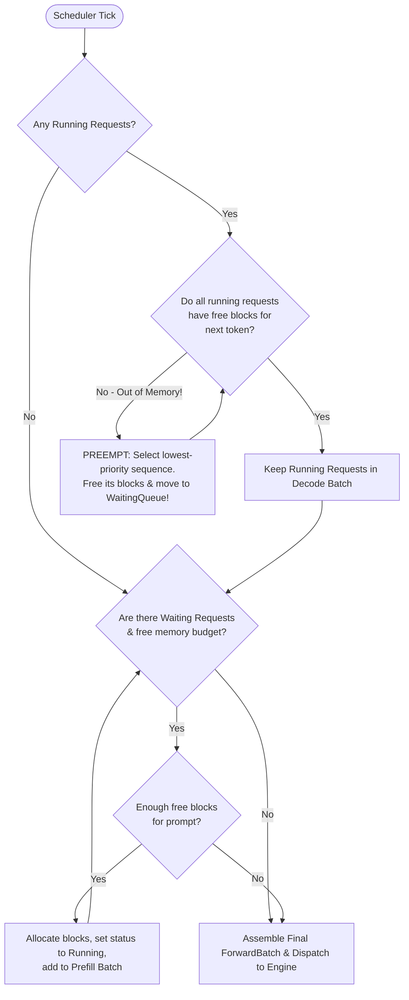

# Module 07: Scheduler & Continuous Batching

## 1. Learning Objectives
- **Iteration-Level Scheduling vs. Request-Level Batching**: Contrast dynamic in-flight iteration scheduling with static batch serving.
- **Prefill vs. Decode Scheduling Policies**: Manage the trade-off between compute-bound prompt prefill and memory-bound decode steps.
- **Preemption & Swapping Strategies**: Prevent deadlock when VRAM runs out mid-generation (Recompute vs. Swap-to-Host).
- **Constructing Continuous Batches**: Dynamically assemble running requests into ragged forward batches.
- **Mermaid Flowcharts**: Trace the decision tree of an iteration scheduler tick.

---

## 2. Conceptual Deep Dive: Continuous Batching (In-Flight Batching)

### Static Batching Failure Case
Consider two requests:
- Request 1: 5-token prompt, generates 100 tokens.
- Request 2: 10-token prompt, generates 2 tokens.

In static batching:
- Request 2 finishes at step 2, but the GPU continues executing step 3..100 with `<pad>` tokens for Request 2 until Request 1 finishes!
- 98 iterations of compute and memory bandwidth are wasted on dummy padding!

### Continuous Batching (Orca / vLLM / TinBox)
In continuous batching:
- The scheduler runs **per iteration (tick)**.
- At step 2, Request 2 emits `is_finished = true`, frees its KV blocks, and exits the batch immediately.
- A new waiting request (Request 3) is immediately admitted and joins the batch at step 3!

```mermaid
gantt
    title Continuous Batching vs Static Batching
    dateFormat  X
    axisFormat %s

    section Static Batching
    Req 1 (Prompt 10 -> Gen 50) :active, 0, 50
    Req 2 (Prompt 10 -> Gen 5)  :crit, 0, 5
    Req 2 Padding (Wasted GPU)   :done, 5, 50

    section Continuous Batching
    Req 1 (Prompt 10 -> Gen 50) :active, 0, 50
    Req 2 (Prompt 10 -> Gen 5)  :crit, 0, 5
    Req 3 (Admitted at Tick 5!)  :active, 5, 30
    Req 4 (Admitted at Tick 30!) :active, 30, 50
```



---

## 3. Scheduler Decision Tree

Every time the engine loop ticks, the scheduler decides which requests execute in the upcoming forward pass:



---

## 4. The Implementation Code

Below is the Rust code for Module 07. You will write this into `src/runtime/scheduler.rs`.

```rust
use crate::error::Result;
use crate::memory::kv_cache::BlockManager;
use crate::types::{RequestId, Sequence, SequenceStatus};
use std::collections::{HashMap, VecDeque};

pub struct SchedulerConfig {
    pub max_batch_size: usize,
    pub max_num_batched_tokens: usize,
}

pub struct ScheduledBatch {
    pub sequences: Vec<RequestId>,
    pub is_prefill: bool,
}

pub struct Scheduler {
    pub config: SchedulerConfig,
    pub waiting_queue: VecDeque<Sequence>,
    pub running_map: HashMap<RequestId, Sequence>,
    pub block_manager: BlockManager,
}

impl Scheduler {
    pub fn new(config: SchedulerConfig, block_manager: BlockManager) -> Self {
        Self {
            config,
            waiting_queue: VecDeque::new(),
            running_map: HashMap::new(),
            block_manager,
        }
    }

    pub fn add_sequence(&mut self, sequence: Sequence) {
        self.waiting_queue.push_back(sequence);
    }

    pub fn schedule(&mut self) -> Result<ScheduledBatch> {
        let mut scheduled_ids = Vec::new();

        let mut preempt_candidate_ids: Vec<RequestId> = self.running_map.keys().cloned().collect();
        let running_ids_to_process: Vec<RequestId> = self.running_map.keys().cloned().collect();

        for req_id in running_ids_to_process {
            let seq = self.running_map.get(&req_id).unwrap();
            let current_len = seq.len();

            match self.block_manager.append_token(&req_id, current_len) {
                Ok(_) => {
                    scheduled_ids.push(req_id);
                }
                Err(_) => {
                    if let Some(victim_id) = preempt_candidate_ids.pop() {
                        if let Some(mut victim_seq) = self.running_map.remove(&victim_id) {
                            victim_seq.status = SequenceStatus::Preempted;
                            self.block_manager.free_sequence(&victim_id);
                            self.waiting_queue.push_front(victim_seq);
                        }
                    }
                }
            }
        }

        while scheduled_ids.len() < self.config.max_batch_size {
            if let Some(waiting_seq) = self.waiting_queue.front() {
                let prompt_blocks_needed = waiting_seq.prompt_tokens.len().div_ceil(self.block_manager.block_size);

                if self.block_manager.allocator.num_free_blocks() >= prompt_blocks_needed {
                    let mut seq = self.waiting_queue.pop_front().unwrap();
                    self.block_manager.allocate_for_prompt(&seq)?;
                    seq.status = SequenceStatus::Running;
                    let id = seq.id.clone();
                    self.running_map.insert(id.clone(), seq);
                    scheduled_ids.push(id);
                } else {
                    break;
                }
            } else {
                break;
            }
        }

        let is_prefill = scheduled_ids.iter().any(|id| {
            self.running_map.get(id).is_some_and(|s| s.output_tokens.is_empty())
        });

        Ok(ScheduledBatch {
            sequences: scheduled_ids,
            is_prefill,
        })
    }

    pub fn cleanup_finished(&mut self, finished_ids: &[RequestId]) {
        for id in finished_ids {
            self.running_map.remove(id);
            self.block_manager.free_sequence(id);
        }
    }
}
```

---

## 5. Exercises & Verification

1. **Unit Test Exercise**:
   - Write a unit test in `tests/test_module_07.rs`.
   - Verify continuous batch scheduling and prefill batch distinction.

2. **Failure-Case Exercise**:
   - Simulate memory exhaustion causing preemption of a running sequence to the waiting queue.

3. **Measurement & Reasoning Exercise**:
   - Trace FIFO scheduling order and remaining block budget under partial admission (see `solutions/module_07.md`).
