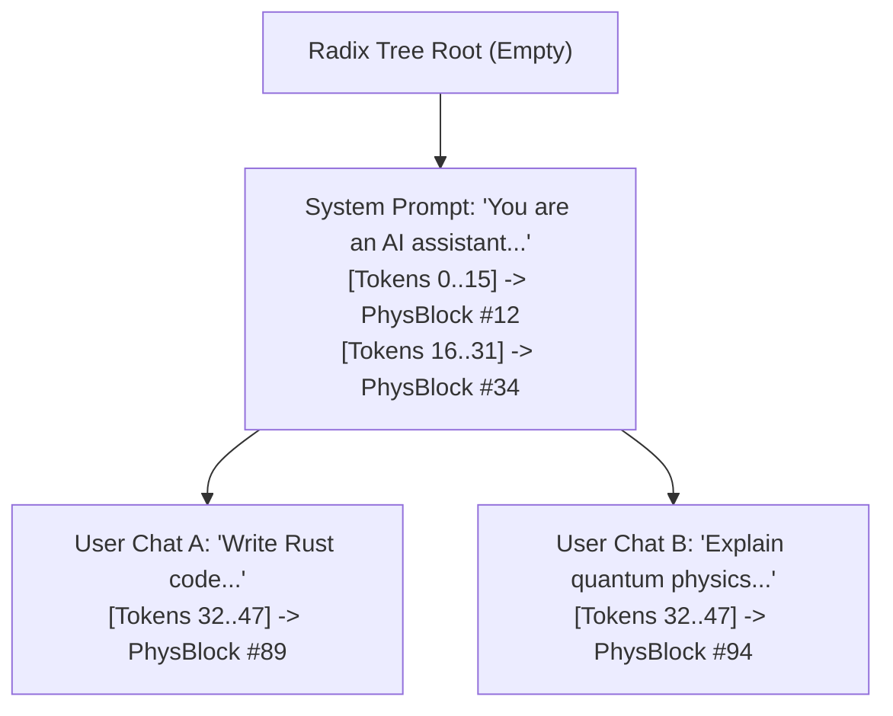
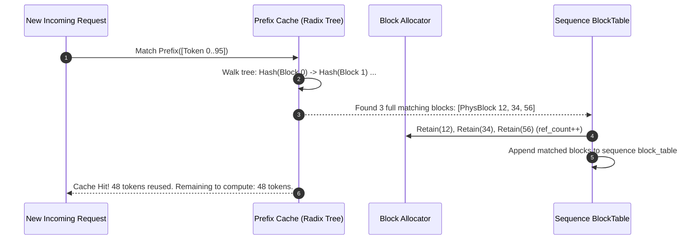

# Module 08: Prefix Caching & Automatic Prefix Reuse

## 1. Learning Objectives
- **Understand the Cost of Redundant Prefills**: Analyze repeated system prompts, few-shot templates, and multi-turn chat sessions.
- **Master Prefix Hashing & Radix Trees**: Design cryptographic / xxHash-based prefix trees matching common token sub-sequences in $\mathcal{O}(K)$ time.
- **Integrate Block Sharing with Reference Counts**: Point new sequence block tables directly to pre-computed physical blocks.
- **Implement LRU Eviction for Cached Blocks**: Evict dormant prefix blocks when memory pressure rises.
- **Mermaid Radix Tree Diagrams**: Visualize how multi-turn conversations branch and share memory nodes.

---

## 2. Conceptual Deep Dive: RadixAttention & Prefix Caching

### The Multi-Turn Chat Redundancy Problem
In multi-turn chat agents, coding assistants, or document QA:
```text
Turn 1: [System Prompt (2,000 tokens)] + [User 1 (50 tokens)] -> Model answers (100 tokens)
Turn 2: [System Prompt (2,000 tokens)] + [User 1 (50)] + [Bot 1 (100)] + [User 2 (40 tokens)]
```
In Turn 2, standard engines re-compute all 2,150 previous tokens from scratch! This wastes massive amounts of GPU power and causes high Time-To-First-Token (TTFT) latency.

### The Radix Hash Tree Solution
By caching previously computed physical KV blocks in a **Radix Tree** keyed by token hashes:
1. Turn 2 arrives with 2,190 total tokens.
2. The engine looks up the longest matching prefix in the Radix Tree $\to$ finds 2,150 tokens already resident in physical memory blocks!
3. The engine only runs prefill for the **40 new tokens**, achieving up to a **$10\times - 50\times$ speedup** in TTFT!



---

## 3. Prefix Block Hashing Formulation

A physical block contains `block_size` tokens (e.g. 16 tokens).
To ensure a block is strictly deterministic:
$$\text{Block Hash} = \text{Hash}(\text{Parent Block Hash}, \text{Tokens}[0..15])$$
By incorporating the parent block's hash, two identical sentences that appear at different context positions have different hashes, preventing position-embedding collisions.



---

## 4. The Implementation Code

Below is the Rust code for Module 08. You will write this into `src/memory/prefix_cache.rs`.

```rust
use crate::memory::block_allocator::PhysicalBlockId;
use crate::types::TokenId;
use std::collections::HashMap;

/// A node in the Radix Prefix Tree.
pub struct RadixNode {
    /// Token values stored in this block/edge.
    pub tokens: Vec<TokenId>,
    /// The physical block holding the computed KV cache for these tokens.
    pub physical_block: PhysicalBlockId,
    /// Child nodes branching from this prefix. Keyed by the first token of the next block.
    pub children: HashMap<TokenId, RadixNode>,
    /// Timestamp of last access (for LRU eviction).
    pub last_accessed: u64,
}

impl RadixNode {
    pub fn new(tokens: Vec<TokenId>, physical_block: PhysicalBlockId) -> Self {
        Self {
            tokens,
            physical_block,
            children: HashMap::new(),
            last_accessed: 0,
        }
    }
}

/// The Radix Prefix Cache managing zero-copy KV block reuse.
pub struct PrefixCache {
    /// Root edges keyed by the initial token ID.
    pub roots: HashMap<TokenId, RadixNode>,
    pub block_size: usize,
    pub hits: usize,
    pub misses: usize,
}

impl PrefixCache {
    pub fn new(block_size: usize) -> Self {
        Self {
            roots: HashMap::new(),
            block_size,
            hits: 0,
            misses: 0,
        }
    }

    /// Searches for the longest matching prefix of physical blocks for the given tokens.
    /// Returns the matched physical block IDs and the number of reused tokens.
    pub fn match_prefix(&mut self, tokens: &[TokenId]) -> (Vec<PhysicalBlockId>, usize) {
        if tokens.is_empty() {
            return (Vec::new(), 0);
        }

        let mut matched_blocks = Vec::new();
        let mut tokens_matched = 0;

        let mut current_map = &mut self.roots;
        let mut token_offset = 0;

        while token_offset < tokens.len() {
            let first_token = tokens[token_offset];
            if let Some(node) = current_map.get_mut(&first_token) {
                // Verify the entire block matches
                let node_len = node.tokens.len();
                if token_offset + node_len <= tokens.len()
                    && &tokens[token_offset..token_offset + node_len] == node.tokens.as_slice()
                {
                    matched_blocks.push(node.physical_block);
                    tokens_matched += node_len;
                    token_offset += node_len;
                    current_map = &mut node.children;
                    continue;
                }
            }
            break;
        }

        if tokens_matched > 0 {
            self.hits += 1;
        } else {
            self.misses += 1;
        }

        (matched_blocks, tokens_matched)
    }

    /// Inserts a newly computed block sequence into the Radix Tree.
    pub fn insert_block(&mut self, tokens: &[TokenId], block_id: PhysicalBlockId) {
        if tokens.len() != self.block_size {
            return; // Only cache full blocks
        }

        let first_token = tokens[0];
        self.roots.entry(first_token).or_insert_with(|| {
            RadixNode::new(tokens.to_vec(), block_id)
        });
    }
}
```

---

## 5. Exercises & Verification

1. **Verify Prefix Hit Rates**:
   - Create a common system prompt of 32 tokens (2 blocks of size 16).
   - Insert both blocks into the `PrefixCache`.
   - Submit Request 1 with `[System Prompt] + [Question 1]`. Verify `tokens_matched == 32`.
   - Submit Request 2 with `[System Prompt] + [Question 2]`. Verify `tokens_matched == 32`.
   - Check that `hits == 2` and `misses == 0`.
