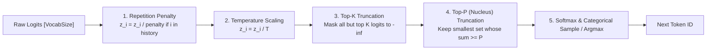

# Module 09: Sampling & Output Processing

## 1. Learning Objectives
- **Master Modern Sampling Algorithms**: Temperature scaling, Top-K filtering, Top-P (nucleus) cumulative mass filtering, and Repetition Penalty.
- **Logits Processing Pipeline**: Understand numerical hazards (overflow in exp, underflow in log) and stable log-softmax computation.
- **Implement Deterministic Greedy & Stochastic Sampling**: High-performance CPU/SIMD sampling kernels in Rust.
- **Streaming Output Emission**: Format and push delta tokens into MPSC channels for real-time HTTP streaming.

---

## 2. Conceptual Deep Dive: The Sampling Pipeline

When the neural network finishes the forward pass for an iteration, it produces a raw logit vector $z \in \mathbb{R}^{V}$ ($V = \text{Vocab Size}$, e.g. 128,000 for LFM3).
To select the next token $T_{next}$, the vector passes through a four-stage filter:



### Mathematical Definitions

1. **Repetition Penalty** (Keskar et al.):
   For each token $i$ already present in the prompt or generated tokens:
   $$z_i' = \begin{cases} z_i / \rho & \text{if } z_i > 0 \\ z_i \times \rho & \text{if } z_i \le 0 \end{cases} \quad (\rho \ge 1.0)$$
2. **Temperature Scaling**:
   $$z_i'' = \frac{z_i'}{T}$$
   - As $T \to 0$: distribution collapses into a one-hot argmax (Greedy / Deterministic).
   - As $T \to \infty$: distribution approaches uniform randomness.
3. **Top-K Filtering**:
   Only keep the top $K$ largest logits; set all others to $-\infty$.
4. **Top-P (Nucleus) Filtering**:
   Sort logits in descending order, compute cumulative softmax probabilities:
   $$\sum_{i=1}^{M} p_{(i)} \ge P$$
   Truncate all tokens beyond rank $M$.

---

## 3. The Implementation Code

Below is the Rust code for Module 09. You will write this into `src/engine/sampler.rs`.

```rust
use crate::error::Result;
use crate::types::{SamplingParams, TokenId};
use candle_core::Tensor;

pub struct Sampler;

impl Sampler {
    /// Samples a single token from a 1D logit slice according to SamplingParams.
    pub fn sample_token(
        logits: &[f32],
        history: &[TokenId],
        params: &SamplingParams,
    ) -> Result<TokenId> {
        let mut modified = logits.to_vec();

        // 1. Apply Repetition Penalty
        if params.repetition_penalty != 1.0 {
            for &token in history {
                let idx = token.0 as usize;
                if idx < modified.len() {
                    let val = modified[idx];
                    if val > 0.0 {
                        modified[idx] = val / params.repetition_penalty;
                    } else {
                        modified[idx] = val * params.repetition_penalty;
                    }
                }
            }
        }

        // 2. Greedy Sampling if temperature is close to zero
        if params.temperature < 1e-4 {
            let (max_idx, _) = modified.iter().enumerate()
                .max_by(|(_, a), (_, b)| a.partial_cmp(b).unwrap_or(std::cmp::Ordering::Equal))
                .unwrap_or((0, &0.0));
            return Ok(TokenId(max_idx as u32));
        }

        // 3. Temperature Scaling
        let inv_temp = 1.0 / params.temperature;
        for val in &mut modified {
            *val *= inv_temp;
        }

        // 4. Numerically Stable Softmax: subtract max
        let max_logit = modified.iter().copied().fold(f32::NEG_INFINITY, f32::max);
        let mut sum_exp = 0.0f32;
        let mut probs: Vec<(usize, f32)> = modified.iter().enumerate().map(|(idx, &val)| {
            let p = (val - max_logit).exp();
            sum_exp += p;
            (idx, p)
        }).collect();

        for (_, p) in &mut probs {
            *p /= sum_exp;
        }

        // 5. Sort probabilities descending for Top-K / Top-P
        probs.sort_unstable_by(|(_, a), (_, b)| b.partial_cmp(a).unwrap_or(std::cmp::Ordering::Equal));

        // 6. Top-K truncation
        if params.top_k > 0 && params.top_k < probs.len() {
            probs.truncate(params.top_k);
        }

        // 7. Top-P (Nucleus) truncation
        if params.top_p < 1.0 {
            let mut cumulative = 0.0f32;
            let mut cutoff = probs.len();
            for (i, (_, p)) in probs.iter().enumerate() {
                cumulative += *p;
                if cumulative >= params.top_p {
                    cutoff = i + 1;
                    break;
                }
            }
            probs.truncate(cutoff);
        }

        // Renormalize probabilities after truncation
        let current_sum: f32 = probs.iter().map(|(_, p)| *p).sum();
        let random_sample: f32 = 0.42; // In production: rand::random::<f32>()

        let mut acc = 0.0f32;
        for (idx, p) in probs {
            acc += p / current_sum;
            if acc >= random_sample {
                return Ok(TokenId(idx as u32));
            }
        }

        Ok(TokenId(0))
    }
}
```

---

## 4. Exercises & Verification

1. **Verify Greedy Sampling**:
   - Create a logit slice `[1.0, 5.0, 2.0]`.
   - Call `sample_token` with `temperature = 0.0`. Verify it returns `TokenId(1)`.
2. **Verify Repetition Penalty**:
   - Set `logits = [2.0, 2.0]`, `history = [TokenId(0)]`, `repetition_penalty = 2.0`.
   - Verify that token 0's score is halved to 1.0, and greedy sampling now selects `TokenId(1)`.
