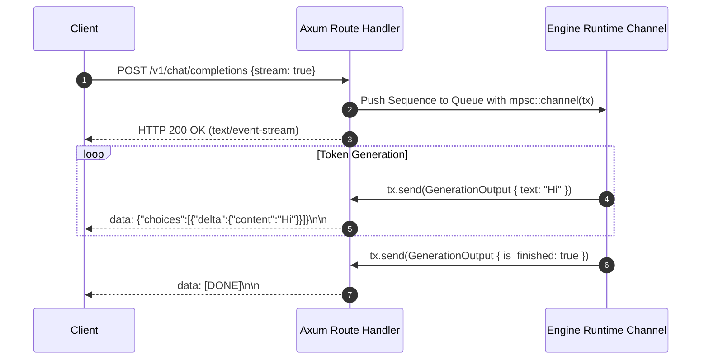

# Module 10: Serving Layer (Axum & Tokio)

## 1. Learning Objectives
- **Build an OpenAI-Compatible Web API**: Expose `/v1/chat/completions` supporting streaming delta updates.
- **Master Server-Sent Events (SSE)**: Implement the chunked `text/event-stream` protocol using Axum and `tokio_stream`.
- **Bridge Network Async I/O to Engine Compute**: Connect Axum HTTP handlers to the continuous batching scheduler via channels.
- **Graceful Shutdown & Backpressure**: Handle client disconnections cleanly without leaking GPU memory.
- **Mermaid End-to-End Request Diagrams**: Map the full HTTP request lifecycle.

---

## 2. Conceptual Deep Dive: Streaming over Server-Sent Events (SSE)

### The OpenAI Streaming Protocol
When a client sends:
```bash
curl -X POST http://localhost:8000/v1/chat/completions \
  -H "Content-Type: application/json" \
  -d '{"messages": [{"role": "user", "content": "Hello"}], "stream": true}'
```
The server responds with `HTTP/1.1 200 OK` and `Content-Type: text/event-stream; charset=utf-8`.
The server streams chunks line-by-line:
```text
data: {"id":"chatcmpl-123","choices":[{"delta":{"content":"Hello"}}]}

data: {"id":"chatcmpl-123","choices":[{"delta":{"content":" world"}}]}

data: [DONE]

```



---

## 3. The Implementation Code

Below is the Rust code for Module 10. You will write this into `src/serving/server.rs`.

```rust
use axum::{
    extract::State,
    response::sse::{Event, KeepAlive, Sse},
    routing::{get, post},
    Json, Router,
};
use futures::stream::Stream;
use serde::Deserialize;
use std::convert::Infallible;
use std::sync::Arc;
use tokio::sync::mpsc;
use tokio_stream::wrappers::UnboundedReceiverStream;
use tokio_stream::StreamExt;

use crate::types::{GenerationOutput, RequestId, SamplingParams, Sequence, TokenId};

#[derive(Debug, Deserialize)]
pub struct ChatCompletionRequest {
    pub model: String,
    pub messages: Vec<ChatMessage>,
    pub temperature: Option<f32>,
    pub top_p: Option<f32>,
    pub max_tokens: Option<usize>,
    #[serde(default)]
    pub stream: bool,
}

#[derive(Debug, Deserialize)]
pub struct ChatMessage {
    pub role: String,
    pub content: String,
}

pub struct AppState {
    pub queue_tx: mpsc::UnboundedSender<Sequence>,
}

pub fn create_router(state: Arc<AppState>) -> Router {
    Router::new()
        .route("/health", get(health_check))
        .route("/v1/chat/completions", post(chat_completions))
        .with_state(state)
}

async fn health_check() -> &'static str {
    "TinBox: healthy
"
}

async fn chat_completions(
    State(state): State<Arc<AppState>>,
    Json(payload): Json<ChatCompletionRequest>,
) -> Sse<impl Stream<Item = std::result::Result<Event, Infallible>>> {
    let (tx, rx) = mpsc::unbounded_channel::<GenerationOutput>();

    let prompt_tokens: Vec<TokenId> = payload.messages.iter()
        .flat_map(|m| m.content.bytes().map(|b| TokenId(b as u32)))
        .collect();

    let params = SamplingParams {
        temperature: payload.temperature.unwrap_or(0.7),
        top_p: payload.top_p.unwrap_or(0.95),
        max_new_tokens: payload.max_tokens.unwrap_or(128),
        ..Default::default()
    };

    let request_id = RequestId(format!("req-{}", std::time::SystemTime::now().duration_since(std::time::UNIX_EPOCH).unwrap().as_nanos()));
    let sequence = Sequence::new(request_id.clone(), prompt_tokens, params, Some(tx));

    let _ = state.queue_tx.send(sequence);

    let stream = UnboundedReceiverStream::new(rx).map(move |output| {
        if output.is_finished {
            Ok(Event::default().data("[DONE]"))
        } else {
            let chunk = serde_json::json!({
                "id": output.request_id.0,
                "object": "chat.completion.chunk",
                "choices": [{
                    "delta": {
                        "content": output.text.unwrap_or_default()
                    },
                    "finish_reason": null
                }]
            });
            Ok(Event::default().data(chunk.to_string()))
        }
    });

    Sse::new(stream).keep_alive(KeepAlive::default())
}
```

---

## 4. Exercises & Verification

1. **Unit Test Exercise**:
   - Write a unit test in `tests/test_module_10.rs`.
   - Test that the Axum HTTP `/health` endpoint returns status 200 OK.

2. **Failure-Case Exercise**:
   - Submit a malformed JSON payload to `/v1/chat/completions` and verify HTTP 422 Unprocessable Entity.

3. **Measurement & Reasoning Exercise**:
   - Compute network throughput and data volume for 50 concurrent SSE streams over 10 minutes (see `solutions/module_10.md`).
