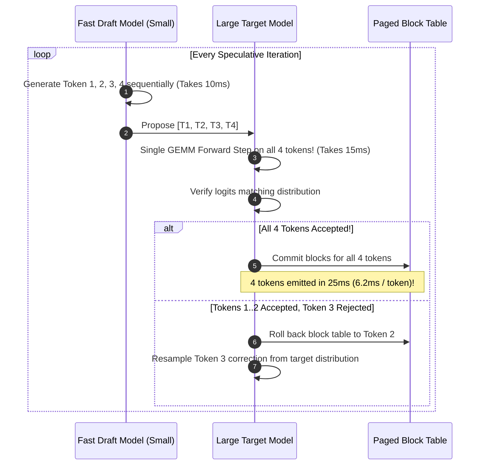
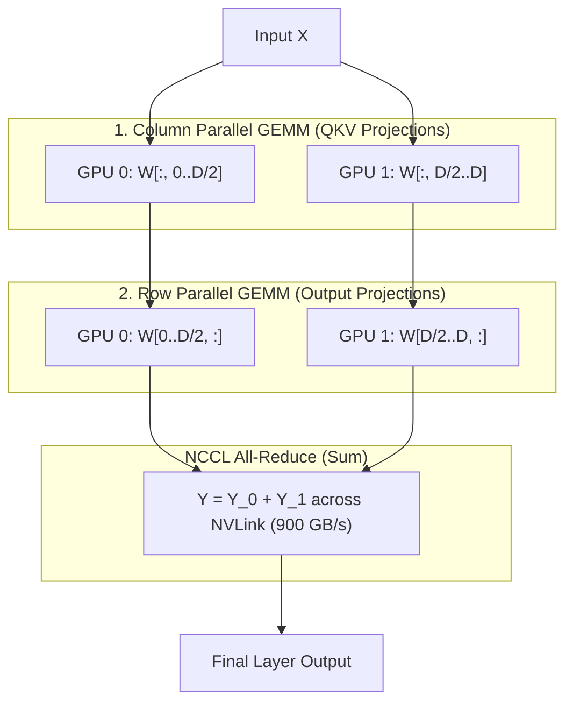

# Module 12: Advanced Topics & Production Frontiers

## 1. Learning Objectives
- **Explore Speculative Decoding**: Draft-verify speculative pipelines producing 2–4 tokens per forward step.
- **Understand Tensor Parallelism (TP)**: Megatron-LM style row-parallel and column-parallel tensor distribution using NCCL / CUDA IPC.
- **Investigate Kernel Fusion Opportunities**: Fusing RMSNorm + GEMM, and RoPE + QKV projections.
- **Production Observability & Metrics**: Tracing TTFT (Time-To-First-Token), TPOT (Time-Per-Output-Token), and physical block utilization metrics via Prometheus / OpenTelemetry.

---

## 2. Speculative Decoding Architecture

Because LLM generation is memory-bandwidth bound, generating 1 token takes nearly the same time as generating 5 tokens in parallel if the tokens are known in advance!
In **Speculative Decoding**:
1. A small, fast **Draft Model** (e.g. 100M parameter model) generates $K$ candidate tokens sequentially.
2. The large **Target Model** (e.g. 70B parameter model) validates all $K$ tokens in a **single forward step**.
3. If $M \le K$ tokens pass the verification criterion, all $M$ tokens are accepted simultaneously, yielding up to a **$2\times - 3\times$ speedup** without any loss in generation quality!

---

## 3. Multi-GPU Tensor Parallelism (Megatron-LM Style)

When a model is too large to fit in a single GPU's VRAM, or to scale memory bandwidth across GPUs, weights are sharded across $N$ GPUs:

---

## 4. Production Metrics & Observability

In production inference runtimes, three primary metrics define service health:

1. **TTFT (Time-To-First-Token)**:
   - Measures prompt prefill latency.
   - Dominated by GEMM compute and prompt length.
   - Optimized by **Prefix Caching** and **Chunked Prefill**.
2. **TPOT (Time-Per-Output-Token)**:
   - Measures inter-token generation latency during decode.
   - Dominated by memory bandwidth ($GEMV$).
   - Optimized by **FP8 weights**, **PagedAttention**, and **Speculative Decoding**.
3. **KV Cache Memory Utilization**:
   $$\text{Block Pool Utilization} = \frac{\text{Allocated Blocks}}{\text{Total Physical Blocks}}$$
   - If utilization exceeds 95%, the scheduler preempts low-priority requests to avoid out-of-memory crashes.
