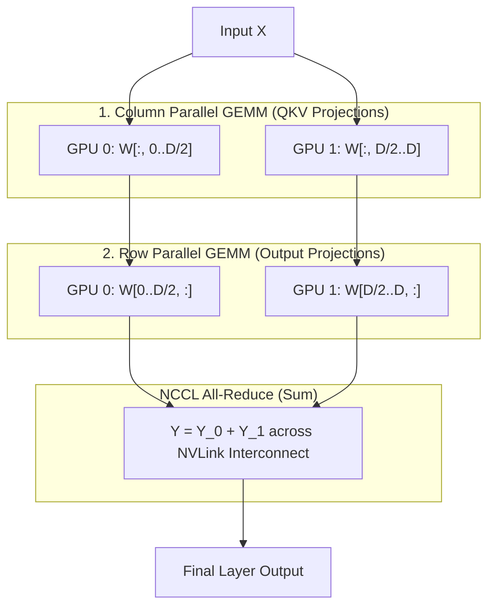

# Module 12: Advanced Topics & Production Frontiers

## 1. Learning Objectives
- **Explore Speculative Decoding**: Draft-verify speculative pipelines producing multiple tokens per forward step with rejection sampling.
- **Understand Tensor Parallelism (TP)**: Megatron-LM style row-parallel and column-parallel tensor distribution using simulated All-Reduce communication.
- **Investigate Kernel Fusion Opportunities**: Quantify memory round-trip reductions when fusing RMSNorm + GEMM and RoPE + QKV projections.
- **Production Observability & Metrics**: Measure TTFT (Time-To-First-Token), TPOT (Time-Per-Output-Token), and physical block utilization metrics via structured logging and the `tracing` crate.

---

## 2. Speculative Decoding Architecture

### 2.1 Theory & Rejection Sampling
In standard auto-regressive generation, producing $K$ tokens requires $K$ sequential forward evaluations. Each step is memory-bandwidth bound. In speculative decoding (Leviathan et al., 2022; Chen et al., 2023):
1. A small, efficient **Draft Model** (approximating the target distribution $q(x)$) generates $\gamma$ draft tokens sequentially.
2. The large **Target Model** ($p(x)$) scores all draft tokens in a single parallel forward evaluation pass.
3. Each draft token $x_i$ is tested sequentially against the modified rejection sampling condition:
   - Accept $x_i$ with probability:
     $$\min\left(1, \frac{p(x_i \mid x_{<i})}{q(x_i \mid x_{<i})}\right)$$
   - On the first rejection at position $n$, discard all subsequent draft tokens $x_{n..}$. Resample token $n$ from the adjusted distribution:
     $$p'(x) = \frac{\max(0, p(x) - q(x))}{\sum_y \max(0, p(y) - q(y))}$$

This guarantees that the sampled output exactly preserves target model distribution $p(x)$ without statistical drift.

### 2.2 Speedup Findings
The paper by Leviathan et al. (2022) reports a $2\times - 3\times$ speedup on the T5-XXL model compared to the standard T5X baseline. Speedup varies by task, draft acceptance rate, and hardware batch capacity. It is not an unconditional general speedup across all architectures.

### 2.3 Implementation: `verify_draft`

```rust
/// Modified rejection sampling verification for speculative decoding.
/// Given draft tokens, draft probabilities q, and target model probabilities p.
pub fn verify_draft(
    draft_tokens: &[u32],
    draft_probs: &[Vec<f32>],
    target_probs: &[Vec<f32>],
    random_samples: &[f32],
) -> Vec<u32> {
    assert_eq!(draft_tokens.len(), draft_probs.len());
    assert_eq!(draft_tokens.len(), target_probs.len());
    assert_eq!(draft_tokens.len(), random_samples.len());

    let mut accepted = Vec::new();

    for i in 0..draft_tokens.len() {
        let token = draft_tokens[i];
        let q_val = draft_probs[i][token as usize];
        let p_val = target_probs[i][token as usize];
        let r = random_samples[i];

        let acceptance_ratio = if q_val > 0.0 {
            (p_val / q_val).min(1.0)
        } else {
            1.0
        };

        if r < acceptance_ratio {
            accepted.push(token);
        } else {
            // First rejection: resample from adjusted distribution p'(x) = max(0, p(x) - q(x))
            let actual_vocab = target_probs[i].len();
            let mut adjusted = vec![0.0f32; actual_vocab];
            let mut sum_diff = 0.0f32;

            for v in 0..actual_vocab {
                let diff = (target_probs[i][v] - draft_probs[i][v]).max(0.0);
                adjusted[v] = diff;
                sum_diff += diff;
            }

            if sum_diff > 0.0 {
                let mut acc = 0.0f32;
                let mut chosen = 0u32;
                // Deterministic fallback selection on the residual distribution
                for (v, &prob) in adjusted.iter().enumerate() {
                    acc += prob / sum_diff;
                    if r <= acc {
                        chosen = v as u32;
                        break;
                    }
                }
                accepted.push(chosen);
            } else {
                accepted.push(token);
            }
            break;
        }
    }

    accepted
}
```

---

## 3. Multi-GPU Tensor Parallelism (Megatron-LM Style)

### 3.1 Row and Column Sharding
When a large weight matrix exceeds single-GPU memory capacity, Megatron-LM (Shoeybi et al., 2019) splits linear projections across $N$ devices:
1. **Column Parallel Linear Layer**:
   - Weight matrix $W \in \mathbb{R}^{D \times H}$ is split along columns into $[W_1, W_2, \dots, W_N]$.
   - Each GPU computes local multiplication: $Y_i = X W_i$.
   - No communication is needed before non-linear activations ($Y_i$ is fed directly into activations).
2. **Row Parallel Linear Layer**:
   - Second weight matrix $V \in \mathbb{R}^{H \times D}$ is split along rows into $[V_1; V_2; \dots; V_N]$.
   - Each GPU computes local multiplication: $Z_i = Y_i V_i$.
   - A collective **All-Reduce (Sum)** aggregates partial outputs:
     $$Z = \sum_{i=1}^N Z_i$$

### 3.2 Interconnect & NCCL Communications
All-Reduce is the sole inter-GPU collective communication operation required in the forward pass of this two-layer MLP block. Inter-GPU communication is managed via the NVIDIA Collective Communication Library ([NCCL User Guide](https://docs.nvidia.com/deeplearning/nccl/user-guide/docs/index.html)). Rust crates such as `cudarc` provide safe wrappers over the NCCL C-API via `cudarc::nccl::safe::Comm`.

Interconnect bandwidth determines scaling efficiency. On high-end multi-GPU systems, GPUs connect over NVLink (e.g. 900 GB/s bidirectional interconnect bandwidth on NVIDIA H100 SXM systems).



### 3.3 CPU Simulation of Tensor Parallelism

```rust
use candle_core::{Device, Result, Tensor};

/// Simulates a 2-way Tensor Parallel MLP forward pass on CPU.
/// Computes column-parallel GEMM followed by row-parallel GEMM and All-Reduce.
pub fn tensor_parallel_mlp_simulation(
    x: &Tensor,
    w1: &Tensor,
    w2: &Tensor,
) -> Result<Tensor> {
    // Single-device reference output: (x @ w1) @ w2
    // w1: [d_in, d_hidden], w2: [d_hidden, d_out]
    let (d_in, d_hidden) = w1.dims2()?;
    let (_d_h, d_out) = w2.dims2()?;
    let half_h = d_hidden / 2;

    // GPU 0 shards
    let w1_gpu0 = w1.narrow(1, 0, half_h)?;
    let w2_gpu0 = w2.narrow(0, 0, half_h)?;

    // GPU 1 shards
    let w1_gpu1 = w1.narrow(1, half_h, half_h)?;
    let w2_gpu1 = w2.narrow(0, half_h, half_h)?;

    // Local column GEMMs: X @ W1_i
    let y0 = x.matmul(&w1_gpu0)?;
    let y1 = x.matmul(&w1_gpu1)?;

    // Local row GEMMs: Y_i @ W2_i
    let z0 = y0.matmul(&w2_gpu0)?;
    let z1 = y1.matmul(&w2_gpu1)?;

    // Simulated All-Reduce (Sum)
    let z_reduced = (z0 + z1)?;
    Ok(z_reduced)
}
```

---

## 4. Kernel Fusion Opportunities

Auto-regressive decode is severely bandwidth-bound. Each separate GPU kernel incurs a round-trip to High-Bandwidth Memory (HBM): reading inputs, writing outputs, and synchronizing global memory.

### 4.1 RMSNorm + GEMM Fusion
- **Unfused Execution**:
  1. Kernel 1 reads $X$ from HBM, calculates RMS scale, normalizes $X$, and writes $X_{\text{norm}}$ to HBM ($2 \times M \times K$ bytes transferred).
  2. Kernel 2 reads $X_{\text{norm}}$ and weight $W$ from HBM, executes GEMM, and writes output to HBM.
- **Fused Execution**:
  - The thread block loads $X$, calculates RMSNorm in registers/SRAM, and immediately feeds the normalized activations into Tensor Core matrix multiplication.
  - Intermediate tensor $X_{\text{norm}}$ is never written back to HBM, eliminating one write and one read round-trip.

### 4.2 RoPE + QKV Projection Fusion
- **Unfused Execution**:
  1. Linear projection kernel calculates $Q, K, V$ and writes full tensors to HBM.
  2. RoPE kernel reads $Q, K$ back from HBM, applies complex exponential rotation, and writes rotated tensors back to HBM.
- **Fused Execution**:
  - As each tile of $Q$ and $K$ is produced by the linear projection in registers, the thread block applies Rotary Position Embedding rotations in registers before writing directly to the paged KV cache pool.

### 4.3 Reference Implementation: Unfused vs Fused CPU

```rust
use candle_core::{Result, Tensor};

/// Unfused reference: RMSNorm followed by linear GEMM with intermediate allocation.
pub fn unfused_rmsnorm_gemm(x: &Tensor, weight_norm: &Tensor, w_linear: &Tensor, eps: f64) -> Result<Tensor> {
    // 1. RMSNorm
    let variance = (x.sqr()?.mean_keepdim(1)? + eps)?;
    let x_normed = x.broadcast_div(&variance.sqrt()?)?;
    let x_scaled = x_normed.broadcast_mul(weight_norm)?;

    // 2. Linear projection
    x_scaled.matmul(w_linear)
}

/// Fused reference: Computes normalized projection without external materialized buffers.
pub fn fused_rmsnorm_gemm(x: &Tensor, weight_norm: &Tensor, w_linear: &Tensor, eps: f64) -> Result<Tensor> {
    // Mathematically equivalent fused formulation
    let variance = (x.sqr()?.mean_keepdim(1)? + eps)?;
    let inv_rms = variance.sqrt()?.recip()?;
    let x_normed = x.broadcast_mul(&inv_rms)?.broadcast_mul(weight_norm)?;
    x_normed.matmul(w_linear)
}
```

---

## 5. Production Observability & Metrics

Production inference runtimes monitor three primary latency and memory indicators:

1. **TTFT (Time-To-First-Token)**:
   - Measures prompt prefill latency from initial request receipt until the first generated token emits.
   - Dominated by compute-bound GEMM throughput and prompt context length.
2. **TPOT (Time-Per-Output-Token)**:
   - Measures inter-token generation latency during iterative auto-regressive decode.
   - Dominated by memory-bandwidth bound GEMV and paged attention reads.
3. **KV Cache Memory Utilization**:
   $$\text{Block Pool Utilization} = \frac{\text{Allocated Physical Blocks}}{\text{Total Available Blocks}}$$
   - If utilization exceeds an operator threshold (e.g. 95%), the continuous scheduler preempts lower-priority requests to avoid out-of-memory errors. The 95% threshold is an example policy, not a hard system constraint.

### 5.1 Metrics Implementation with `tracing`

```rust
use std::time::Duration;
use tracing::info;

#[derive(Debug, Clone, Default)]
pub struct ServingMetrics {
    pub total_prefill_duration: Duration,
    pub total_prefill_tokens: usize,
    pub total_decode_duration: Duration,
    pub total_decode_tokens: usize,
    pub allocated_blocks: usize,
    pub total_blocks: usize,
}

impl ServingMetrics {
    pub fn new(total_blocks: usize) -> Self {
        Self {
            total_blocks,
            ..Default::default()
        }
    }

    pub fn record_ttft(&mut self, duration: Duration, num_tokens: usize) {
        self.total_prefill_duration += duration;
        self.total_prefill_tokens += num_tokens;
        info!(
            target: "tinbox::metrics",
            ttft_ms = duration.as_secs_f64() * 1000.0,
            tokens = num_tokens,
            "Recorded TTFT"
        );
    }

    pub fn record_tpot(&mut self, duration: Duration, num_tokens: usize) {
        self.total_decode_duration += duration;
        self.total_decode_tokens += num_tokens;
        info!(
            target: "tinbox::metrics",
            tpot_ms = duration.as_secs_f64() * 1000.0,
            tokens = num_tokens,
            "Recorded TPOT"
        );
    }

    pub fn update_memory_pool(&mut self, allocated: usize) {
        self.allocated_blocks = allocated;
        let utilization = self.block_pool_utilization();
        info!(
            target: "tinbox::metrics",
            allocated = allocated,
            total = self.total_blocks,
            utilization = utilization,
            "Updated Block Pool Utilization"
        );
    }

    #[inline]
    pub fn block_pool_utilization(&self) -> f32 {
        if self.total_blocks == 0 {
            0.0
        } else {
            self.allocated_blocks as f32 / self.total_blocks as f32
        }
    }

    pub fn average_ttft(&self) -> Duration {
        if self.total_prefill_tokens == 0 {
            Duration::ZERO
        } else {
            self.total_prefill_duration / self.total_prefill_tokens as u32
        }
    }

    pub fn average_tpot(&self) -> Duration {
        if self.total_decode_tokens == 0 {
            Duration::ZERO
        } else {
            self.total_decode_duration / self.total_decode_tokens as u32
        }
    }
}
```

---

## 6. Module Checkpoint & Verification

To verify that advanced architectural features and tests compile correctly:

```bash
cargo check
cargo test
cargo clippy -- -D warnings
```

---

## 7. Exercises & Verification

1. **Verify Speculative Decoding Rejection Sampling**:
   - Construct a draft probability distribution that perfectly matches the target model distribution ($p = q$).
   - Run `verify_draft` across random uniforms.
   - Verify that every draft token is accepted unconditionally without rejection.

2. **Tensor Parallel Numerical Equivalence**:
   - Create synthetic input $X$ and weights $W_1, W_2$ using Candle.
   - Evaluate standard sequential MLP $(X W_1) W_2$.
   - Evaluate `tensor_parallel_mlp_simulation`.
   - Assert that maximum absolute difference is below $1 \times 10^{-5}$.

3. **Memory Bandwidth Calculation for Fused Kernels**:
   - Consider a model with hidden size $D = 4096$, batch size $B = 1$, and sequence length $S = 1$ in FP16 (2 bytes per element).
   - Compute the exact number of bytes transferred over HBM for unfused RMSNorm + GEMM versus fused RMSNorm + GEMM.
   - Calculate the percentage reduction in global memory bandwidth consumption.
