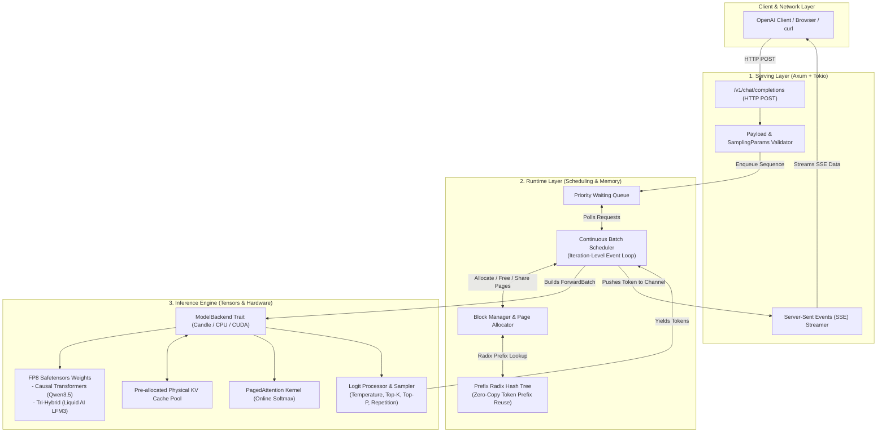

# TinBox: Educational ML Runtime & Inference Engine in Rust

Welcome to **TinBox**, an educational, production-grade Large Language Model (LLM) Runtime and Inference Engine written in Rust.

This repository is designed as a complete masterclass curriculum demystifying how modern high-throughput LLM serving systems like **vLLM**, **SGLang**, and **TensorRT-LLM** work under the hood.

---

## 🏗️ System Architecture Overview



---

## 📚 Curriculum Structure: Modules 00 Through 12

The repository is structured as 13 educational modules. Each module contains deep conceptual explanations, hardware diagrams, architectural trade-offs, and complete, compilable Rust code listings:

1. [**Module 00: Project Scaffold & System Architecture Philosophy**](MODULE_00_PROJECT_SCAFFOLD.md)
   - Auto-regressive decode vs. prefill bottlenecks, vLLM / SGLang / TensorRT-LLM comparison, hardware memory topology, and Cargo setup.
2. [**Module 01: Core Types & Request Lifecycle**](MODULE_01_CORE_TYPES.md)
   - Sequence state machine, request lifecycle, MPSC streaming channels, type-safe identifiers.
3. [**Module 02: Memory Management Foundation**](MODULE_02_MEMORY_MANAGEMENT.md)
   - Paging theory, internal vs. external fragmentation, physical block allocators, atomic reference counting, and Copy-on-Write (COW).
4. [**Module 03: KV Cache & Paged Memory Layout**](MODULE_03_KV_CACHE.md)
   - Multi-dimensional tensor pool layouts, logical-to-physical address translation arithmetic, and dynamic sequence block tables.
5. [**Module 04: Model Loading & FP8 Representation**](MODULE_04_MODEL_LOADING.md)
   - FP8 E4M3 vs. E5M2 numerics, dequantization formulas, Liquid AI LFM3 tri-hybrid architecture, and synthetic FP8 model generation.
6. [**Module 05: Model Execution Backend**](MODULE_05_MODEL_EXECUTION.md)
   - Abstract `ModelBackend` trait, 1D ragged token batching, forward pass execution, and Candle backend.
7. [**Module 06: Attention Kernels & Paged Attention**](MODULE_06_ATTENTION_KERNELS.md)
   - PagedAttention algorithm, Online Softmax formulation, NVIDIA `cuda-rust` (`cutile-rs` / `cuda-oxide`) integration, and reference implementation.
8. [**Module 07: Scheduler & Continuous Batching**](MODULE_07_SCHEDULER.md)
   - Iteration-level scheduling, continuous in-flight batching, prefill vs. decode priorities, and preemption policies.
9. [**Module 08: Prefix Caching & Automatic Prefix Reuse**](MODULE_08_PREFIX_CACHING.md)
   - RadixAttention trees, multi-turn chat prefix hashing, and zero-copy block sharing.
10. [**Module 09: Sampling & Output Processing**](MODULE_09_SAMPLING.md)
    - Temperature scaling, Top-K, Top-P (nucleus), repetition penalties, and logits pipelines.
11. [**Module 10: Serving Layer (Axum & Tokio)**](MODULE_10_SERVING_LAYER.md)
    - OpenAI-compatible `/v1/chat/completions` API, Server-Sent Events (SSE) streaming, and graceful shutdown.
12. [**Module 11: Integration, Testing & End-to-End Polish**](MODULE_11_INTEGRATION_TESTING.md)
    - Complete engine runtime loop, end-to-end testing instructions, and system comparison tables.
13. [**Module 12: Advanced Topics & Production Frontiers**](MODULE_12_ADVANCED_TOPICS.md)
    - Speculative decoding pipelines, Megatron-style tensor parallelism, and production observability metrics (TTFT, TPOT).

---

## 🚀 Quickstart & Building

### 1. Build the Project
```bash
cargo check
cargo build --release
```

### 2. Run Tests
```bash
cargo test
```

### 3. Launch the Server
```bash
cargo run --release
```

### 4. Test Streaming Chat Completion
```bash
curl -N -X POST http://127.0.0.1:8000/v1/chat/completions \
  -H "Content-Type: application/json" \
  -d '{
    "messages": [{"role": "user", "content": "Explain TinBox"}],
    "stream": true,
    "temperature": 0.7
  }'
```
