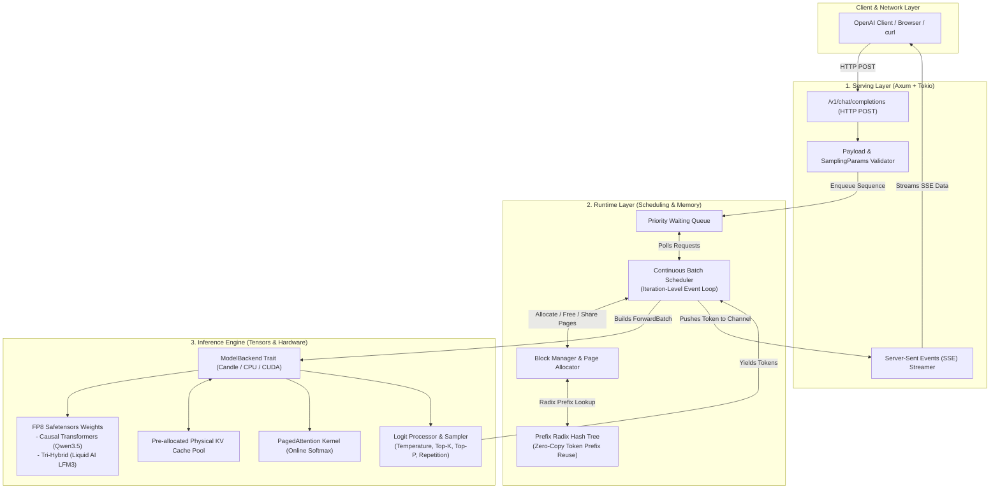

# TinBox: Educational ML Runtime & Inference Engine in Rust

Welcome to **TinBox**, an educational Large Language Model (LLM) Runtime and Inference Engine written in Rust.

This repository is designed as a complete masterclass curriculum demystifying how modern high-throughput LLM serving systems like **vLLM**, **SGLang**, and **TensorRT-LLM** work under the hood.

---

## System Architecture Overview



---

## Curriculum Structure: Modules 00 Through 12

The repository is structured as 13 educational modules. Each module contains deep conceptual explanations, hardware diagrams, architectural trade-offs, and complete, compilable Rust code listings:

1. [**Module 00: Project Scaffold & System Architecture Philosophy**](MODULE_00_PROJECT_SCAFFOLD.md)
   - Auto-regressive decode vs. prefill bottlenecks, vLLM / SGLang / TensorRT-LLM comparison, hardware memory topology, and Cargo setup.
2. [**Module 01: Core Types & Request Lifecycle**](MODULE_01_CORE_TYPES.md)
   - Sequence state machine, request lifecycle, MPSC streaming channels, type-safe identifiers.
3. [**Module 02: Memory Management Foundation**](MODULE_02_MEMORY_MANAGEMENT.md)
   - Paging theory, internal vs. external fragmentation, physical block allocators, atomic reference counting, and Copy-on-Write (COW).
4. [**Module 03: KV Cache & Paged Memory Layout**](MODULE_03_KV_CACHE.md)
   - Multi-dimensional tensor pool layouts, logical-to-physical address translation arithmetic, and dynamic sequence block tables.
5. [**Module 04: Model Loading & FP8 Representation**](MODULE_04_MODEL_LOADING.md)
   - FP8 E4M3 vs. E5M2 numerics, dequantization formulas, Liquid AI LFM3 tri-hybrid architecture, and synthetic FP8 model generation.
6. [**Module 05: Model Execution Backend**](MODULE_05_MODEL_EXECUTION.md)
   - Abstract `ModelBackend` trait, 1D ragged token batching, forward pass execution, and Candle backend.
7. [**Module 06: Attention Kernels & Paged Attention**](MODULE_06_ATTENTION_KERNELS.md)
   - PagedAttention algorithm, Online Softmax formulation, NVIDIA `cuda-rust` (`cutile-rs` / `cuda-oxide`) integration, and reference implementation.
8. [**Module 07: Scheduler & Continuous Batching**](MODULE_07_SCHEDULER.md)
   - Iteration-level scheduling, continuous in-flight batching, prefill vs. decode priorities, and preemption policies.
9. [**Module 08: Prefix Caching & Automatic Prefix Reuse**](MODULE_08_PREFIX_CACHING.md)
   - RadixAttention trees, multi-turn chat prefix hashing, and zero-copy block sharing.
10. [**Module 09: Sampling & Output Processing**](MODULE_09_SAMPLING.md)
    - Temperature scaling, Top-K, Top-P (nucleus), repetition penalties, and logits pipelines.
11. [**Module 10: Serving Layer (Axum & Tokio)**](MODULE_10_SERVING_LAYER.md)
    - OpenAI-compatible `/v1/chat/completions` API, Server-Sent Events (SSE) streaming, and graceful shutdown.
12. [**Module 11: Integration, Testing & End-to-End Polish**](MODULE_11_INTEGRATION_TESTING.md)
    - Complete engine runtime loop, end-to-end testing instructions, and system comparison tables.
13. [**Module 12: Advanced Topics & Production Frontiers**](MODULE_12_ADVANCED_TOPICS.md)
    - Speculative decoding pipelines, Megatron-style tensor parallelism, and production observability metrics (TTFT, TPOT).

---

## Implementation Status

| Module | Name | Compiles | Tested | GPU-Verified |
| :--- | :--- | :--- | :--- | :--- |
| **00** | Project Scaffold & Architecture | Yes | Yes | No (CUDA toolkit optional/fallback) |
| **01** | Core Types & Request Lifecycle | Yes | Yes | N/A (CPU Host logic) |
| **02** | Memory Management Foundation | Yes | Yes | N/A (CPU Host logic) |
| **03** | KV Cache & Paged Memory Layout | Yes | Yes | No (CPU Host / Paged Pool reference) |
| **04** | Model Loading & FP8 Representation | Yes | Yes | N/A (CPU dequantization) |
| **05** | Model Execution Backend | Yes | Yes | No (Candle CPU fallback) |
| **06** | Attention Kernels & Paged Attention | Yes | Yes | No (CPU reference verified; GPU design sketch) |
| **07** | Scheduler & Continuous Batching | Yes | Yes | N/A (CPU Host logic) |
| **08** | Prefix Caching & Automatic Prefix Reuse | Yes | Yes | N/A (CPU Host logic) |
| **09** | Sampling & Output Processing | Yes | Yes | N/A (CPU Host logic) |
| **10** | Serving Layer (Axum & Tokio) | Yes | Yes | N/A (CPU Host network stack) |
| **11** | Integration, Testing & End-to-End | Yes | Yes | No (Candle CPU runtime) |
| **12** | Advanced Topics & Production Frontiers | Yes | Yes | No (CPU simulation references) |

---

## Supported Architectures & Model Cards
- **Liquid AI LFM3-1.7B**: Tri-Hybrid architecture combining gated 1D convolutions, sliding window attention, and full causal attention. [Model Card: LiquidAI/LFM3-1.7B](https://huggingface.co/LiquidAI/LFM3-1.7B).
- **Qwen3 / Qwen3.5**: Dense multi-head and grouped-query causal transformers with rotary position embeddings (RoPE). [Model Card: Qwen/Qwen2.5-Coder-7B](https://huggingface.co/Qwen).

---

## Sources & Technical References
- **PagedAttention & vLLM**: Kwon et al., *Efficient Memory Management for Large Language Model Serving with PagedAttention*, SOSP 2023. [arXiv:2309.06180](https://arxiv.org/abs/2309.06180)
- **RadixAttention & SGLang**: Zheng et al., *SGLang: Efficient Execution of Structured Language Model Programs*, 2023. [arXiv:2312.07104](https://arxiv.org/abs/2312.07104)
- **FlashAttention**: Dao et al., *FlashAttention: Fast and Memory-Efficient Exact Attention with IO-Awareness*, NeurIPS 2022. [arXiv:2205.14135](https://arxiv.org/abs/2205.14135)
- **Online Softmax**: Milakov & Gimelshein, *Online normalizer calculation for softmax*, 2018. [arXiv:1805.02867](https://arxiv.org/abs/1805.02867)
- **Speculative Decoding**: Leviathan, Kalman, & Matias, *Fast Inference from Transformers via Speculative Decoding*, ICML 2023. [arXiv:2211.17192](https://arxiv.org/abs/2211.17192)
- **Speculative Sampling**: Chen et al., *Accelerating Large Language Model Decoding with Speculative Sampling*, 2023. [arXiv:2302.01318](https://arxiv.org/abs/2302.01318)
- **Megatron-LM Tensor Parallelism**: Shoeybi et al., *Megatron-LM: Training Multi-Billion Parameter Language Models Using Model Parallelism*, 2019. [arXiv:1909.08053](https://arxiv.org/abs/1909.08053)
- **NVIDIA cuTile Rust**: [cuTile Rust Documentation](https://nvlabs.github.io/cutile-rs/main/)
- **NVIDIA CUDA Rust Overview**: [Introducing CUDA Rust: Two Tracks for Writing GPU Kernels](https://developer.nvidia.com/blog/introducing-cuda-rust-two-tracks-for-writing-gpu-kernels/)
- **Hugging Face Grout**: [Hugging Face Grout cuTile-rs Qwen3 Inference Engine](https://github.com/huggingface/grout)
- **NVIDIA NCCL User Guide**: [NCCL Collective Communication User Guide](https://docs.nvidia.com/deeplearning/nccl/user-guide/docs/index.html)
- **Cargo Features Reference**: [The Cargo Book: Features](https://doc.rust-lang.org/cargo/reference/features.html)

---

## Quickstart & Building

### 1. Build the Project
```bash
cargo check
cargo build --release
```

### 2. Run Tests
```bash
cargo test
```

### 3. Launch the Server
```bash
cargo run --release
```

### 4. Test Streaming Chat Completion
```bash
curl -N -X POST http://127.0.0.1:8000/v1/chat/completions \
  -H "Content-Type: application/json" \
  -d '{
    "messages": [{"role": "user", "content": "Explain TinBox"}],
    "stream": true,
    "temperature": 0.7
  }'
```
